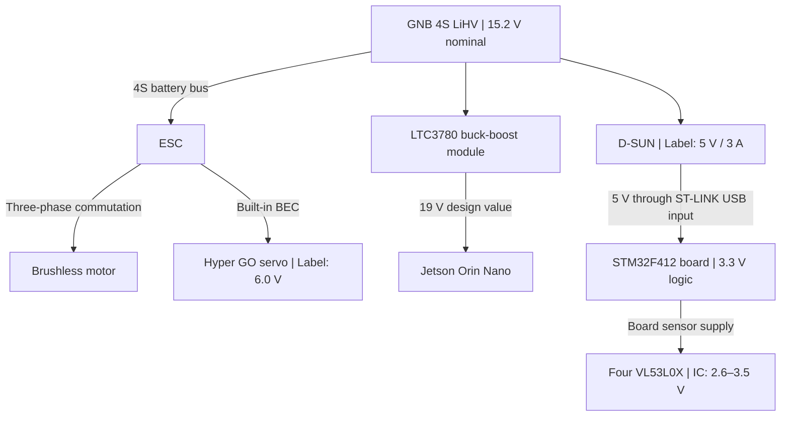
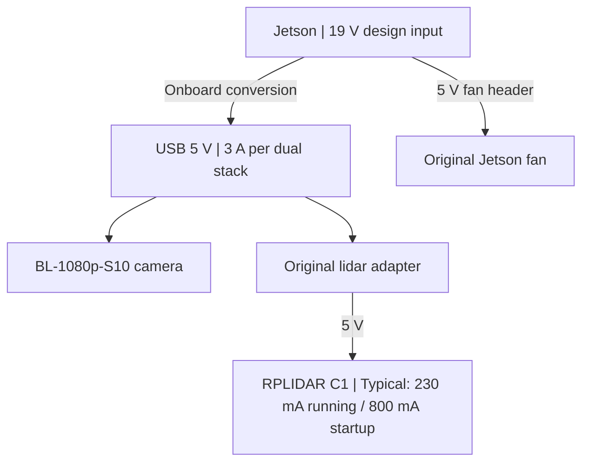
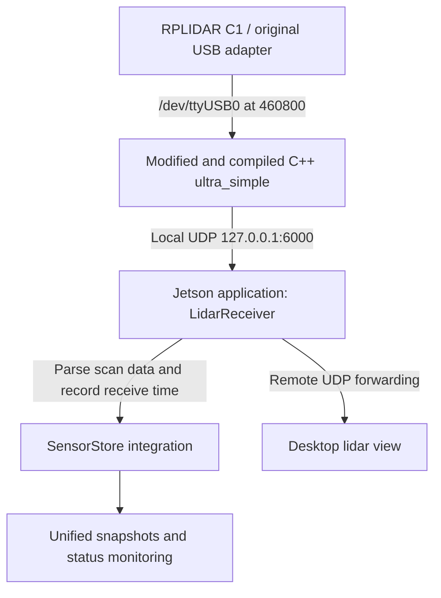
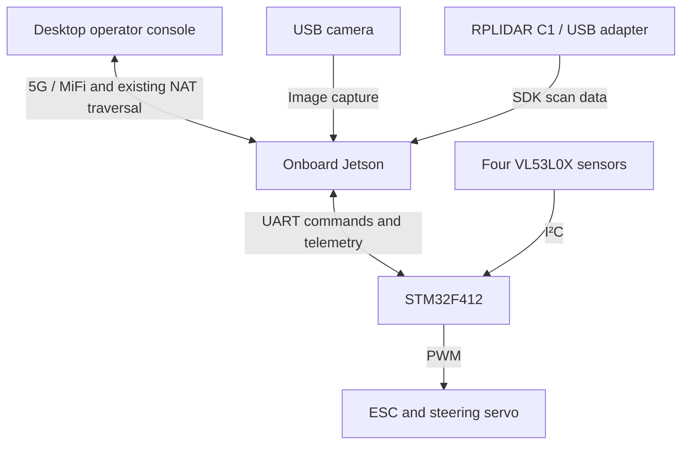

# Smart Car | Jetson Orin Nano × STM32 Embedded AI Patrol and Obstacle Avoidance System: Edge Inference, Heterogeneous Computing, and Real-Time Control

> **I independently completed this project from the ground up within one year.**
>
> I began with **vehicle hardware planning and component selection**, followed by **power distribution, regulated supply configuration, and physical wiring**. I then developed the **STM32 control firmware and Jetson onboard software**. I also **retrained the model with added vacant-space images, produced best.pt, and deployed it on Jetson**, integrating multiple sensors, AI inference, remote operation, and vehicle control.

[](https://youtu.be/pAVebk_odPo)

## [▶ Watch the Smart Car Vehicle Demo](https://youtu.be/pAVebk_odPo)

[繁體中文](README.md) · [Hardware and wiring](docs/hardware.md) · [System architecture](docs/architecture.md) · [Model training](docs/model-training.md) · [Deployment](docs/operation.md) · [Original build logs](logs/README.md)

The system combines hardware, Linux-based onboard computing, microcontroller firmware, and a desktop operator interface. The Jetson Orin Nano handles vision inference, network transport, and higher-level decisions; the STM32F412 handles PWM, UART frame parsing, and independent distance-based protection. Development progressed from individual device checks to complete vehicle integration. Early source code, build logs, and staged change notes are retained alongside the current implementation so readers can trace how the system took shape.

## Complete Vehicle Engineering — Independently Completed

| Engineering area | Work I completed independently | System outcome |
| --- | --- | --- |
| Hardware and power integration | Selected computing and control boards, sensors, and actuators; arranged battery branches, regulated supplies, USB peripheral power, BEC-powered steering, board mounting, and signal wiring | Connected the propulsion, computing, and control loads into a working vehicle system |
| Jetson platform setup | Established the Python/GPU inference environment, addressed PyTorch/torchvision compatibility, and built torchvision's ARM and CUDA extensions from source | Connected camera input and the trained model to the actual onboard runtime |
| Lidar code modification and compilation | Modified the vendor C++ lidar application, added scan-data conversion and local UDP transmission, compiled an ARM64 executable for Jetson, and implemented reception and sensor integration in the Python application | Connected device acquisition, C++ builds, main-application reception, remote forwarding, and boot services |
| STM32 real-time control | Wrote firmware in C; configured clocks, GPIO, hardware timers, and PWM; implemented UART parsing, CRC8, four-ToF management, a protective state machine, and watchdog supervision | Converted network commands into throttle and steering signals while retaining protection independent of the Jetson |
| Motor EMI and communication reliability | Addressed motor-generated electromagnetic interference under material and schedule constraints using UART with CRC-8, corrupted-frame rejection, resynchronization, and command-timeout protection | Integrated the Jetson–M4 control link and achieved normal vehicle operation |
| Custom data and model retraining | Added vacant-space images to the training data, retrained a YOLOv8 segmentation model with the custom `vacant` class, and produced and deployed `best.pt` | Retained 81-class weights and integrated onboard inference, segmentation visualization, and remote video return; [Training and deployment steps](docs/model-training.md) |
| Perception and data transport | Integrated a USB camera, the `best.pt` segmentation model, ByteTrack, RPLIDAR C1, and four VL53L0X sensors; transported images, scans, ranges, and status | Gave the operator a combined view of the camera image, recognition results, and surrounding distances |
| Networking and remote operation | Used a dedicated 5G network SIM, an onboard MiFi, and the deployment's NAT-traversal configuration; separated video, control, and lidar channels | Connected the vehicle to a remote desktop console and handled pairing, disconnection, and control recovery |
| Concurrency and control ownership | Separated inference/transmission processes and UART/lidar threads; added queues, locks, exclusive access, freshness checks, and mode handoffs | Prevented vision work from blocking control and multiple tasks from competing for the motor UART |
| Deployment and operator tools | Consolidated the desktop dashboard, service installation and management, boot startup, status monitoring, and recording export | Turned separately launched development programs into a deployable, operable, and diagnosable system |

The hardware integrates an off-the-shelf chassis, development boards, and power/sensor modules. The vendor HAL, CMSIS, sensor APIs, and lidar SDK are documented in [Third-party sources and licensing](THIRD_PARTY_NOTICES.md).

## Development: From Individual Components to a Complete Vehicle

Development began with hardware and power planning, followed by platform setup, control firmware, model training, and vehicle integration.

| Stage | Work performed | Source code and technical documents |
| --- | --- | --- |
| 1. Plan the vehicle electronics | Define the Jetson/M4 division of work; install the battery, ESC, servo, camera, lidar, and boards; arrange power branches, common ground, and signal connections | [Hardware photographs](archive/photos/), [Power and wiring notes](docs/hardware.md) |
| 2. Bring up the Jetson environment | Establish the board's runtime environment, check GPU-package/Python compatibility, prepare CUDA build settings, and compile torchvision | [Build command notes](notes/compile_torchvision.txt), [Full build output](logs/torchvision_build.log) |
| 3. Establish motor and steering control | Implement STM32 PWM outputs and a UART command channel, connect the Jetson serial port, and establish neutral values and command ranges | [Early UART bridge](archive/early_sources/jetson_motor_uart_verbose.py), [Early M4 source](archive/early_sources/main(1).c), [Current complete firmware project](firmware/stm32f4/) |
| 4. Add vacant-space data and retrain the model | Include vacant-space images, retrain the custom-class segmentation model, and produce `best.pt` for onboard deployment | [Model weights](jetson/best.pt), [Training steps and classes](docs/model-training.md) |
| 5. Connect sensing and remote data | Modify the C++ lidar application, compile an ARM64 executable, and connect it to the Jetson application over local UDP; integrate vision, keyboard control, and return data | [C++ lidar modifications](jetson/rplidar_sdk-master/app/ultra_simple/main.cpp), [Python reception and forwarding](jetson/minitesla_sensors/io.py), [Build and deployment](docs/operation.md) |
| 6. Integrate the programs into a concurrent system | Assign camera/inference, video transport, and sensor reception to appropriate processes or threads within the vehicle application | [Early integrated version](archive/early_sources/minitesla(2).py), [Current vehicle application](jetson/minitesla.py) |
| 7. Add four-direction ranging and protection | Add independent XSHUT control, address assignment, validity checks, and telemetry for four ToF sensors; place throttle protection on the M4 | [Four-ToF integration notes](archive/release_notes/01_MiniTesla_Phase1_2_Replace_v1.md), [M4 firmware](firmware/stm32f4/Core/Src/main.c) |
| 8. Handle motor EMI, disconnection, and races | Address motor interference through UART/CRC-8, frame-error handling, and command-timeout protection; add display acknowledgements, control handoff, and a single UART writer | [Communication reliability](docs/architecture.md), [Concurrency fix notes](archive/release_notes/04_MiniTesla_Phase4_ConcurrencyFix_v1.md), [Control authority](jetson/minitesla_sensors/control.py) |
| 9. Consolidate operation and deployment | Integrate person alerts, reactive obstacle-avoidance patrol, the desktop dashboard, startup services, and status-recording tools | [Dashboard](pc/pc_dashboard.py), [Reactive autonomy](jetson/minitesla_sensors/autonomy.py), [Service management](jetson/minitesla_service.py), [Recorder](jetson/demo_recorder.py) |

## Hardware Engineering: Power, Installation, and Wiring


*The assembled vehicle: battery, chassis, and multiple electronics platforms mounted on standoffs. [More original hardware photographs](archive/photos/)*

### Components, Supply Voltages, and Loads

The main battery feeds **three branches: propulsion, Jetson computing, and M4 control**. I designed and wired the power distribution, converters, board supplies, and signal connections. The camera, lidar, and ranging sensors use their host boards' power, while the steering servo uses the ESC's built-in battery eliminator circuit (BEC).

| Component | Supply source and voltage | Specification and integration |
| --- | --- | --- |
| GNB / GAONENG 4S LiHV battery | Main supply, **15.2 V nominal** | **6000 mAh, 130C**; label specifies a 4.35 V charging limit per cell, or 17.4 V for four cells |
| Blue LTC3780 buck-boost module | 4S battery → **19 V design rail** | Supplies the Jetson and its onboard and USB loads |
| NVIDIA Jetson Orin Nano Developer Kit | LTC3780 → **19 V DC input** (project design value) | Linux, vision inference, lidar integration, networking, and high-level control |
| D-SUN buck converter | 4S battery → **5 V** | [Packaging marked MP1584EN, 5 V / 3 A](archive/photos/104661_0.jpg); separate M4 branch |
| ST STM32F412ZGT6 / M4 board | D-SUN → ST-LINK USB power input at **5 V**; MCU / UART logic at **3.3 V** | Real-time PWM, UART, four-direction ranging, and independent control protection |
| Electronic speed controller (ESC) | **Direct 4S battery bus**, varying with battery voltage | Drives the brushless motor; built-in BEC supplies the servo |
| Brushless motor (BLDC) | **Three-phase commutated output** from the ESC | M4 PWM commands the ESC; the motor receives switched phase waveforms |
| Hyper GO steering servo | ESC BEC; **6.0 V on the servo label** | [Label: 35 kg·cm, 0.13 s / 60°](archive/photos/104651_0.jpg); separate M4 control signal |
| USB camera, board marked BL-1080p-S10 | Jetson USB **5 V** | Captures images for `best.pt` inference |
| Original lidar USB adapter | Jetson USB **5 V** | USB power, UART conversion, and power delivery to the lidar |
| SLAMTEC RPLIDAR C1 | Adapter **5 V**; operating range **4.8–5.2 V** | At 5 V / 10 Hz: **230 mA typical**, **260 mA maximum**; **800 mA typical startup** |
| Four ST VL53L0X sensors | M4 board supply; **sensor IC range 2.6–3.5 V** | Front/rear/left/right; **19 mA typical** per sensor during ranging, peaks up to **40 mA**; carrier-input details in the [hardware document](docs/hardware.md) |
| Original Jetson heatsink and fan | Carrier-board fan header, **5 V** | Original heatsink and active cooling powered by the board |
| Original ESC / motor cooling assemblies | Original vehicle cooling harness; fan voltage: - | Retains the original cooling arrangement |
| Onboard MiFi and dedicated 5G SIM | - | Mobile connectivity through the existing NAT-traversal deployment |

### Actual Power Distribution

Main battery and controller branches:



Jetson peripheral branch:



**Load allocation:** The Jetson branch supplies the compute board, camera, lidar adapter, lidar, and original fan. The M4 and four ToF sensors use the independent control branch. Motor and servo loads remain on the ESC branch. The boards share ground; UART and PWM carry control signals.

**Current ratings:** Each dual-stacked Jetson USB Type-A connector has a shared **3 A** VBUS limit. The lidar's **800 mA typical startup current** is accounted for separately from its **230 mA typical running current**. The D-SUN's **3 A** is its labeled output capability; the M4 board power path and downstream sensors have their own allocation. See the [complete electrical specifications, sources, and wiring](docs/hardware.md).

### Key Signal Connections

| Signal | Connection / configuration | Implementation detail |
| --- | --- | --- |
| Jetson → M4 | Jetson UART TX → STM32 PA3 / USART2 RX | Vehicle device `/dev/ttyTHS0`, 115200 baud, 8N1 |
| M4 → Jetson | STM32 PA2 / USART2 TX → Jetson UART RX | Returns four-direction ranges and control status; common ground and 3.3 V UART logic |
| Servo control | PA8 → TIM1 CH1 → servo signal wire | M4-generated signal; servo power comes from the BEC |
| ESC control | PA1 → TIM2 CH2 → ESC signal wire | Converts speed and neutral commands into pulse widths |
| Shared four-ToF bus | PB8 = SCL, PB9 = SDA | Open-drain software I²C; sensor reads are managed by the M4 |
| Front / rear / left / right XSHUT | PG10 / PG11 / PG12 / PG13 | Enables the sensors individually to assign distinct addresses |
| Front / rear / left / right 7-bit I²C addresses | `0x30` / `0x31` / `0x32` / `0x33` | Resolves the shared-default-address conflict on the common bus |

The connections can be traced to `pwm_init`, `uart_init`, and the ToF initialization in [`main.c`](firmware/stm32f4/Core/Src/main.c). The vehicle configuration specifies a **47.4 cm length, 32.8 cm width, and 27.5 cm wheelbase**. The lidar's raw 0° faces forward, it is centered laterally, and its angle increases clockwise; see the [vehicle configuration](jetson/minitesla_sensors/vehicle_config.py).

## Model Retraining: Vacant-Space Images to best.pt

For the vehicle's vacant-parking-space recognition task, **I added vacant-space images to the training data, retrained a YOLOv8 instance-segmentation model, produced `best.pt`, and deployed it on the Jetson Orin Nano**. This work covers custom-class model training and integrating the resulting weights into camera inference, segmentation visualization, and remote video return.

The vehicle uses an **81-class YOLOv8s instance-segmentation model**: its class map retains the original 80 COCO class names and adds **`vacant` (class ID 80)**. The deployed weights are [`jetson/best.pt`](jetson/best.pt).

The development sequence was **include vacant-space training images → retrain the custom-class model → produce best.pt → deploy to Jetson → integrate inference and visualization**. Training and model deployment were completed. With limited time for further development, parking-related functions reached a prototype stage and remain extensions. The retained parking planner primarily uses lidar and ToF; it does not yet feed `vacant` vision results directly into automatic-parking decisions.

See [model training and deployment steps](docs/model-training.md) and the [parking prototype](docs/experimental.md).

## Jetson: From Package Setup to Onboard Vision

I established the Jetson Linux, Python, and GPU inference environment, resolved PyTorch/torchvision compatibility issues, and compiled torchvision ARM and CUDA extensions from official source.

- Platform: **Linux AArch64 and Python 3.8**.
- CUDA build: `nvcc` with `TORCH_CUDA_ARCH_LIST="8.7"`, targeting `compute_87` / `sm_87`.
- Build configuration: `MAX_JOBS=1`, with installation into the existing Python environment.
- Successfully built and installed version: **`torchvision 0.16.1+fdea156`**. Full commands and output are available in the [build logs](logs/README.md).

The onboard vision pipeline captures USB-camera images, directly loads the [trained `.pt` model weights](jetson/best.pt), runs Ultralytics segmentation and ByteTrack tracking, draws results with OpenCV, encodes JPEG frames, and returns them to the desktop operator console.

**Implementation:** [Vehicle vision pipeline](jetson/minitesla.py) · [Build commands](notes/compile_torchvision.txt) · [Full build log](logs/torchvision_build.log)

## Lidar Code Modification and Compilation: Connecting Scans to the Jetson Application

I modified the **C++ `ultra_simple` application** in the SLAMTEC lidar software development kit (SDK), adding angle, distance, and quality conversion together with local UDP transmission. I built the modified source using the Makefile and GNU C++ compiler (g++), producing an **ARM64/AArch64 executable** for Jetson, then integrated its data into the Python vehicle application.

| Development stage | Work completed |
| --- | --- |
| Modify lidar acquisition | Integrated scan acquisition and sorting in `app/ultra_simple/main.cpp`, adding socket creation, data formatting, `sendto()`, and resource cleanup |
| Convert scan data | Converted SDK nodes into angle in degrees, distance in millimeters, and quality, formatted as `angle,distance,quality`; sent one UDP datagram per scan point |
| Compile the source | Ran `make` at the SDK root to produce `output/Linux/Release/ultra_simple`; the repository retains the AArch64 executable |
| Connect to the Jetson application | `minitesla.py` starts the `LidarReceiver` thread, receives on `127.0.0.1:6000`, validates fields and values, and updates `SensorStore` with receive timestamps |
| Integrate and forward data | Builds scan data and sector-distance summaries for unified snapshots and status monitoring, and forwards scan points to the desktop lidar view |
| Deploy at boot | Runs the C++ acquisition application as a separate system service managed alongside the Python vehicle application |



Key scan-conversion and transmission code:

```cpp
float angle = (nodes[pos].angle_z_q14 * 90.f) / 16384.f;
float distance = nodes[pos].dist_mm_q2 / 4.0f;
int quality = nodes[pos].quality >> SL_LIDAR_RESP_MEASUREMENT_QUALITY_SHIFT;

char msg[64];
snprintf(msg, sizeof(msg), "%.2f,%.2f,%d", angle, distance, quality);
sendto(udp_socket, msg, strlen(msg), 0,
       (sockaddr*)&udp_target, sizeof(udp_target));
```

The lidar connects to the C++ acquisition application through USB/serial. The C++ application then communicates with the Python application over local UDP. Local sensor updates and remote forwarding are handled separately, so a forwarding failure does not stop local reception.

**Implementation:** [C++ lidar application](jetson/rplidar_sdk-master/app/ultra_simple/main.cpp) · [Build configuration](jetson/rplidar_sdk-master/Makefile) · [Python receiver and forwarding](jetson/minitesla_sensors/io.py) · [Sensor integration](jetson/minitesla_sensors/core.py) · [Build and deployment](docs/operation.md)

## STM32: Real-Time Actuation and Four-Direction Ranging Protection

### Hardware PWM and Bidirectional UART

The firmware directly configures TIM1 and TIM2 for two PWM outputs. With the current 16 MHz time base, prescaler `PSC=159`, and auto-reload register `ARR=1013`, the frequency is approximately **98.6 Hz**. Each count represents **10 μs**, so neutral command `152` corresponds to a **1.52 ms** pulse. These timer settings convert higher-level speed and steering commands into actuator pulse widths.

| Control item | Current firmware setting |
| --- | --- |
| Steering servo | `94–210`, center `152` |
| ESC | Limited to `142–160` in the current protective firmware, neutral `152` |
| UART command | `55 AA 02 SEQ speed turn CRC8`, CRC-8 polynomial `0x07` |
| Command acceptance | Updates the command and reception timestamp only after a complete frame passes validation; malformed or incomplete data is not treated as a fresh control input |

The M4 also returns ranges, validity, and protection state. The Jetson therefore supervises the controller as well as sending speed commands. Telemetry packets are 79 bytes long. Every 50 ms, the foreground loop attempts transmission through TXE interrupts; if transmission is still busy, it skips that update to avoid accumulating outdated status packets.

### Motor EMI: Communication Design Under Material and Schedule Constraints

During vehicle integration, **electromagnetic interference (EMI) from the running motor affected onboard communication**. With limited materials and development time remaining, I focused on protocol-level error detection and fault handling: **a Universal Asynchronous Receiver/Transmitter (UART) link between the Jetson and M4, with an 8-bit cyclic redundancy check (CRC-8)**.

The receiver updates the control command only after a complete frame passes header and CRC checks. It rejects corrupted frames and searches for the next frame boundary. Rejected data does not refresh the accepted-command timestamp; if no CRC-validated command arrives for more than **300 ms**, the M4 latches the ESC at neutral throttle.

**This approach enabled normal vehicle operation.** This development stage integrated UART communication, data validation, and timeout protection; further hardware EMI suppression remains a future revision. See the [system architecture](docs/architecture.md) for the frame format and error-handling flow.

### Four-Direction Ranging and Independent Protection

All four VL53L0X sensors start with the same default address. The firmware controls their XSHUT lines, enables and readdresses each device, and then services them in turn. The implementation covers GPIO sequencing, an I²C platform interface, vendor-API integration, error handling, and measurement timestamps.

At startup, the firmware outputs neutral values to the ESC and servo before initializing the sensors. Protection is evaluated on a **1 ms TIM5 control time base**, independently of camera inference and network transport. The control interrupt performs no I²C reads, delays, or printing, and has a higher priority than the UART interrupt. The foreground loop reads sensors and prepares telemetry packets; USART2 interrupts handle command reception and byte transfers. The independent watchdog (IWDG) is refreshed only when both the foreground loop and the control time base continue to advance.

| Condition | Current firmware response |
| --- | --- |
| Any direction at or below 300 mm | Latch throttle at the ESC neutral value |
| Any required ToF reading invalid, or older than 120 ms | Treat unknown range as unavailable, and latch throttle at neutral |
| UART command older than 300 ms | Latch throttle at neutral |
| Obstacle cleared | Require all four directions to remain at least 400 mm clear for at least 500 ms, then confirm a neutral command and wait for a subsequent new throttle command before movement resumes |

**Protection latches throttle at the ESC neutral value** while allowing valid, fresh steering commands to remain available. The control policy is checked every 1 ms; the distance thresholds for triggering and clearing protection are 300 mm and 400 mm, respectively.

## 5G Remote Operation and Separate Data Channels



The 5G connection uses **a dedicated-network SIM in an onboard MiFi, which shares its connection with the vehicle**. NAT traversal provides connectivity across networks. At the application level, the Jetson initiates `HELLO` messages so the desktop operator console can establish and pair with the control peer.

| Channel | Purpose and integration details |
| --- | --- |
| TCP 7000: video | Carries JPEG images and frame sequence numbers; capture times and receiver display acknowledgements are used to evaluate freshness |
| UDP 5000: control and status | Vehicle pairing, remote heartbeats, operator commands, operating modes, and sensor-status reports |
| UDP 6000: lidar | Connects the vendor SDK, onboard receiver, and desktop lidar view; lidar serial device `/dev/ttyUSB0` at 460800 baud |
| UART 115200: Jetson ↔ M4 | Validated speed/steering commands and four-direction ranging telemetry |

The dedicated lidar section above describes the C++ modifications, compilation, and local UDP integration. The desktop receives scan data forwarded by the Jetson application.

After a connection recovers, operation resumes through standby and an explicit control handoff, rather than replaying the previous throttle command. Connection recovery and permission to move are handled separately.

## Concurrency: Keeping Vision, Sensing, and Control Working Together

| Execution unit | Responsibility | Resource and synchronization design |
| --- | --- | --- |
| Vision inference process | Camera capture, inference, tracking, annotation, and encoding | Uses `multiprocessing` and bounded queues to deliver data |
| Video transmission process | TCP connection and frame transmission | Separate from inference so network waits do not directly block camera/inference work |
| UART thread | M4 reception/transmission and control dispatch | Sole serial-port owner and writer, preventing driving modes from competing for the device |
| Lidar thread | Scan reception, sensor-state updates, and forwarding | Separate from UART reception, with timestamp-based validity checks |
| Control manager | Manual / standby / autonomous / fault transitions | Shares one control lock across mode decisions, health checks, and UART dispatch |
| Desktop media subprocess and operator interface | Video/lidar reception and display, keyboard control | Separates media processing from the operator window and incorporates focus/video state |

One integration issue addressed explicitly was a race in which **one task had already obtained an old throttle value while another entered a fault state, allowing the first task to send the stale value afterward**. The correction serializes control decisions and UART dispatch under the same lock, rechecking time and sensor health after acquiring it. Inference and long network waits remain outside that lock.

Process locking, pySerial exclusive opening, and Linux terminal-device exclusivity also prevent a second instance of the updated application from taking the serial port. Monitoring tools read snapshots without opening UART. These mechanisms address duplicate processes, device contention, shared state, and stale data separately. A frame already in transmission cannot be recalled, so independent M4 protection remains part of the design.

**Implementation:** [Process and serial exclusivity](jetson/minitesla_sensors/runtime.py) · [Control authority](jetson/minitesla_sensors/control.py) · [UART/lidar workers](jetson/minitesla_sensors/io.py) · [Original concurrency correction notes](archive/release_notes/04_MiniTesla_Phase4_ConcurrencyFix_v1.md)

## From Separate Launch Commands to Managed Deployment

The desktop entry point, [`pc_dashboard.py`](pc/pc_dashboard.py), combines driving controls, annotated video, lidar, four-direction ranges, and status. On the vehicle, [`minitesla_service.py`](jetson/minitesla_service.py) manages installation, boot startup, stopping, restarting, and log inspection for the main application, lidar reader, and recorder.

[`sensor_status.py`](jetson/sensor_status.py) reads sensor snapshots. [`demo_recorder.py`](jetson/demo_recorder.py) can export `samples.csv`, `events.csv`, `records.jsonl`, and a summary for investigating mode changes, ranges, and fault reasons.

| Main demonstration scope | Engineering capability demonstrated |
| --- | --- |
| Remote manual driving with annotated video | A complete chain from vision inference and encoding through network transport and the operator interface to motor control |
| Person alerts, lidar, and four-direction range monitoring | Integration and reporting of heterogeneous sensor data |
| Reactive obstacle-avoidance patrol | Distance-based decisions integrated with control handoff and protection conditions |
| Stopping on communication loss and regaining control | Heartbeat supervision, video freshness, sensor validity, and two layers of control protection |
| Startup services and recording export | Linux deployment, automatic startup, process management, and diagnostics |

Person detection provides alerts, while lidar and four-direction ToF sensing provide distance information. Reactive patrol adjusts the driving direction using current ranges, with control-authority management and M4 protection supervising vehicle outputs.

### Vehicle Demonstration Video

[](https://youtu.be/pAVebk_odPo)

## Source Code and Technical Documents

| Content | Entry point |
| --- | --- |
| Complete vehicle execution flow | [`jetson/minitesla.py`](jetson/minitesla.py) and [`minitesla_sensors/`](jetson/minitesla_sensors/) |
| MCU control and ranging | [`main.c`](firmware/stm32f4/Core/Src/main.c), [`wheelcontrol.uvprojx`](firmware/stm32f4/MDK-ARM/wheelcontrol.uvprojx) |
| Desktop operation | [`pc/`](pc/) |
| Environment build logs | [`logs/`](logs/), [`notes/`](notes/) |
| Development history | [`archive/early_sources/`](archive/early_sources/), [`archive/release_notes/`](archive/release_notes/) |
| Hardware and original documents | [`archive/photos/`](archive/photos/), [`archive/documents/`](archive/documents/) |
| Deployment and validation scope | [Operation guide](docs/operation.md), [Validation notes](docs/validation.md) |

### Parking Prototype and Future Extension

Parking-space search, alignment, and reverse parking remain prototypes. Future development will connect the model’s `vacant` detections with parking planning; see [Experimental extension](docs/experimental.md).
