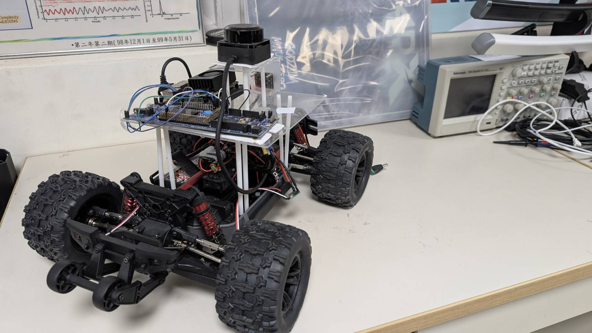
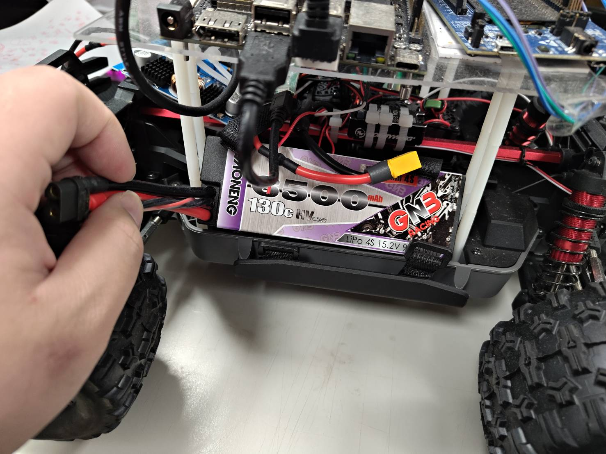
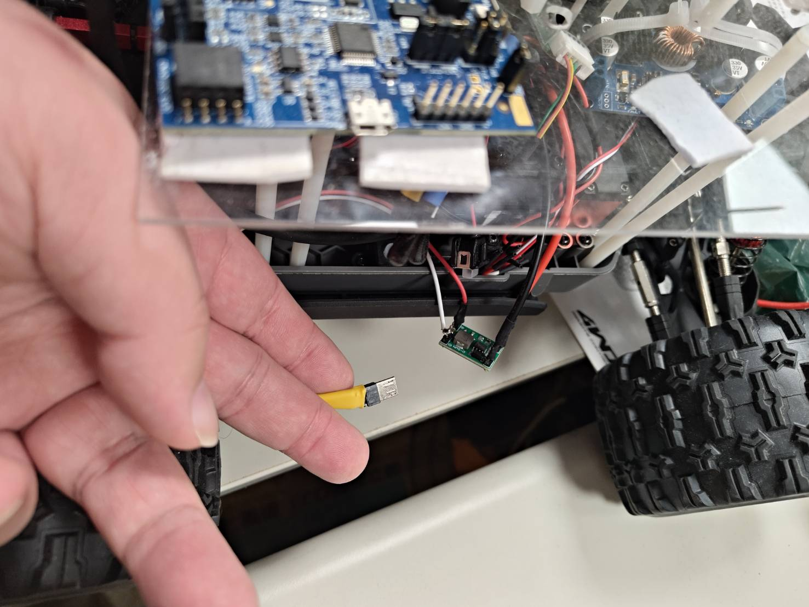
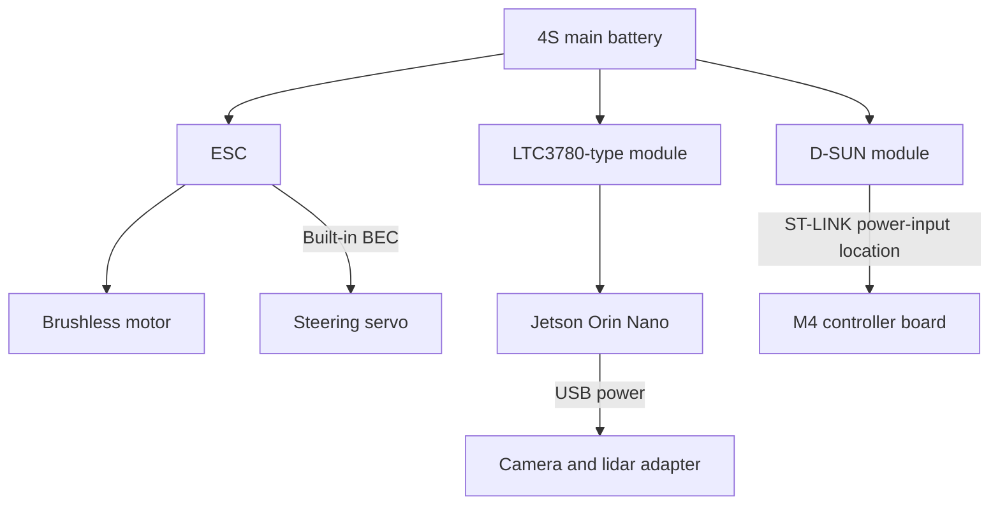
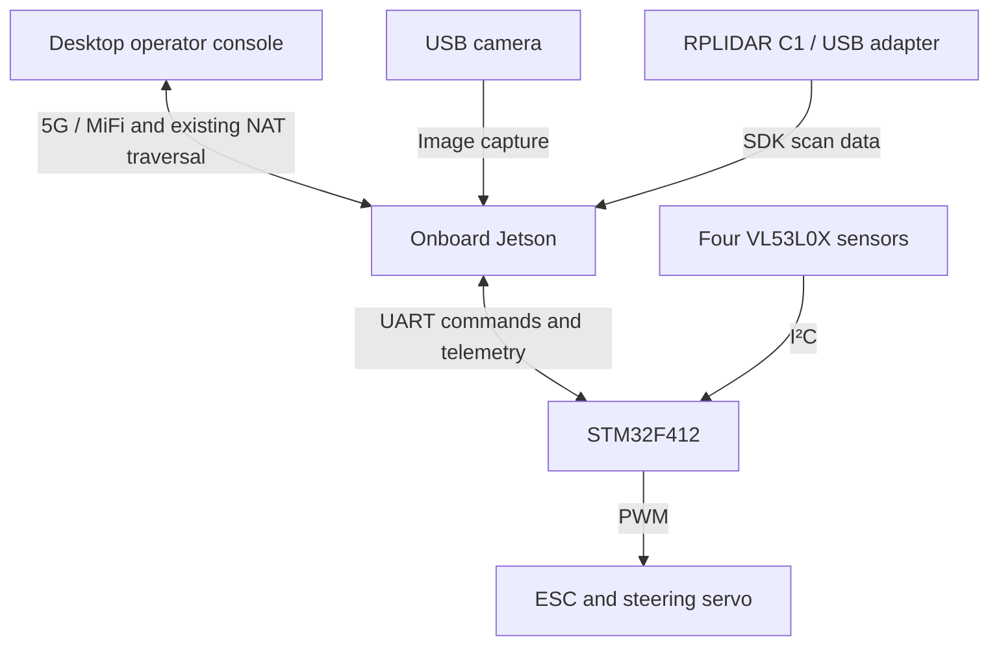

# Smart Car | Jetson Orin Nano × STM32 Embedded AI Patrol and Obstacle Avoidance System: Edge Inference, Heterogeneous Computing, and Real-Time Control

**An independently built personal project — I completed hardware assembly and power wiring, multisensor integration, model training and deployment, parallel processing with multiple processes, and 5G remote operation.**

## [▶ Watch the Smart Car Vehicle Demo](https://youtu.be/pAVebk_odPo)

[繁體中文](README.md) · [Hardware and wiring](docs/hardware.md) · [System architecture](docs/architecture.md) · [Deployment](docs/operation.md) · [Original build logs](logs/README.md)

**Smart Car is a smart RC car project I built independently from the ground up. I selected the chassis and electronic components, planned the power circuits, mounted and wired the modules, set up the Jetson environment, trained and deployed the model, developed the STM32 firmware and desktop interface, and configured 5G remote access. I then integrated vision, lidar, and four-direction ranging and carried out vehicle testing and deployment.**

The work spans hardware, Linux-based onboard computing, microcontroller firmware, and a desktop operator interface. The Jetson Orin Nano handles vision inference, network transport, and higher-level decisions; the STM32F412 handles PWM, UART frame parsing, and independent distance-based protection. Development progressed from individual device checks to complete vehicle integration. Early source code, build logs, and staged change notes are retained alongside the current implementation so readers can trace how the system took shape.

## Complete Vehicle Engineering — Independently Completed

| Engineering area | Work I completed independently | System outcome |
| --- | --- | --- |
| Hardware and power integration | Selected computing and control boards, sensors, and actuators; arranged battery branches, regulated supplies, USB peripheral power, BEC-powered steering, board mounting, and signal wiring | Connected the propulsion, computing, and control loads into a working vehicle system |
| Jetson platform setup | Established the Python/GPU inference environment, addressed PyTorch/torchvision compatibility, and built torchvision's ARM and CUDA extensions from source | Connected camera input and the trained model to the actual onboard runtime |
| STM32 real-time control | Wrote firmware in C; configured clocks, GPIO, hardware timers, and PWM; implemented UART parsing, CRC8, four-ToF management, a protective state machine, and watchdog supervision | Converted network commands into throttle and steering signals while retaining protection independent of the Jetson |
| Perception and data transport | Integrated a USB camera, the `best.pt` segmentation model, ByteTrack, RPLIDAR C1, and four VL53L0X sensors; transported images, scans, ranges, and status | Gave the operator a combined view of the camera image, recognition results, and surrounding distances |
| Networking and remote operation | Used a dedicated 5G network SIM, an onboard MiFi, and the deployment's NAT-traversal configuration; separated video, control, and lidar channels | Connected the vehicle to a remote desktop console and handled pairing, disconnection, and control recovery |
| Concurrency and control ownership | Separated inference/transmission processes and UART/lidar threads; added queues, locks, exclusive access, freshness checks, and mode handoffs | Prevented vision work from blocking control and multiple tasks from competing for the motor UART |
| Deployment and operator tools | Consolidated the desktop dashboard, service installation and management, boot startup, status monitoring, and recording export | Turned separately launched development programs into a deployable, operable, and diagnosable system |

I selected the off-the-shelf chassis, development boards, and power/sensor modules, then independently completed the system design, power distribution, installation and wiring, firmware and application development, and whole-vehicle integration testing. The vendor HAL, CMSIS, sensor APIs, and lidar SDK used in the project are documented in [Third-party sources and licensing](THIRD_PARTY_NOTICES.md).

## Development: From Individual Components to a Complete Vehicle

The stages below follow engineering dependencies. Early and current versions are both preserved for comparison.

| Stage | Work performed | Engineering outputs and evidence |
| --- | --- | --- |
| 1. Plan the vehicle electronics | Define the Jetson/M4 division of work; install the battery, ESC, servo, camera, lidar, and boards; arrange power branches, common ground, and signal connections | [Hardware photographs](archive/photos/), [Power and wiring notes](docs/hardware.md) |
| 2. Bring up the Jetson environment | Establish the board's runtime environment, check GPU-package/Python compatibility, prepare CUDA build settings, and compile torchvision | [Build command notes](notes/compile_torchvision.txt), [Full build output](logs/torchvision_build.log) |
| 3. Establish motor and steering control | Implement STM32 PWM outputs and a UART command channel, connect the Jetson serial port, and establish neutral values and command ranges | [Early UART bridge](archive/early_sources/jetson_motor_uart_verbose.py), [Early M4 source](archive/early_sources/main(1).c), [Current complete firmware project](firmware/stm32f4/) |
| 4. Connect perception and remote data paths individually | Develop image inference, desktop keyboard control, UART forwarding, and lidar reception separately before integrating their data flows | [Early standalone programs](archive/early_sources/), [Lidar SDK](jetson/rplidar_sdk-master/) |
| 5. Integrate the programs into a concurrent system | Assign camera/inference, video transport, and sensor reception to appropriate processes or threads within the vehicle application | [Early integrated version](archive/early_sources/minitesla(2).py), [Current vehicle application](jetson/minitesla.py) |
| 6. Add four-direction ranging and protection | Add independent XSHUT control, address assignment, validity checks, and telemetry for four ToF sensors; place throttle protection on the M4 | [Four-ToF integration notes](archive/release_notes/01_MiniTesla_Phase1_2_Replace_v1.md), [M4 firmware](firmware/stm32f4/Core/Src/main.c) |
| 7. Address disconnection and concurrency problems | Add displayed-frame acknowledgements, command deadlines, control handoffs, a single UART writer, and process/serial exclusivity | [Concurrency correction notes](archive/release_notes/04_MiniTesla_Phase4_ConcurrencyFix_v1.md), [Control authority](jetson/minitesla_sensors/control.py) |
| 8. Consolidate operation and deployment | Integrate person alerts, reactive obstacle-avoidance patrol, the desktop dashboard, startup services, and status-recording tools | [Dashboard](pc/pc_dashboard.py), [Reactive autonomy](jetson/minitesla_sensors/autonomy.py), [Service management](jetson/minitesla_service.py), [Recorder](jetson/demo_recorder.py) |

## Hardware Engineering: Power, Installation, and Wiring

*The assembled vehicle: battery, chassis, and multiple electronics platforms mounted on standoffs. [More original hardware photographs](archive/photos/)*

### Components and Their Integration

| Component | Role and integration work |
| --- | --- |
| NVIDIA Jetson Orin Nano | Onboard Linux computing platform for the camera, lidar, inference, and network transport |
| ST STM32F412ZGT6 / M4 controller board | Real-time vehicle control; the complete Keil project and `.ioc` configuration are retained in `firmware/stm32f4/` |
| 4S battery | Main vehicle supply; the [original battery photograph](archive/photos/104652_0.jpg) shows GNB/GAONENG, 4S 15.2 V, and HV 4.35 V markings |
| Blue LTC3780-type power module | Supplies the Jetson from a battery branch; the Jetson then supplies its USB peripherals |
| D-SUN power module | Supplies the M4 from a separate battery branch, using the board's ST-LINK power-input location |
| ESC, brushless motor, and steering servo | The ESC drives the motor and its built-in battery eliminator circuit (BEC) powers the servo; the M4 provides separate PWM control signals |
| USB camera | Provides camera input to the Jetson; the [camera-board photograph](archive/photos/104650_0.jpg) shows the board marking `BL-1080P-S10` |
| RPLIDAR C1 and its original adapter board | Connects lidar scans to the Jetson over USB and integrates with the SDK and forwarding application |
| Four VL53L0X sensors | Mounted front, rear, left, and right; connected to the M4 through a shared I²C bus and four independent XSHUT lines |
| Onboard MiFi and dedicated 5G network SIM | Provides the vehicle's mobile-network connection through the deployment's existing NAT-traversal arrangement |

### Actual Power Distribution

This work includes **assigning loads to power branches**. The Jetson branch must account for its USB camera and lidar adapter. The ESC's BEC supplies the steering servo. The battery supplies the M4 independently through the D-SUN module, keeping that load outside the Jetson's USB power budget. Peripherals that can use an existing board supply do so, rather than adding a separate converter for every device.

This diagram records the power topology confirmed for the vehicle. Output settings and current capability depend on the actual modules; they cannot be inferred solely from the LTC3780 chip name or a module's appearance. Likewise, 3.3 V signal logic is distinct from a board's power-input specification.

### Key Signal Connections

| Signal | Connection / configuration | Implementation detail |
| --- | --- | --- |
| Jetson → M4 | Jetson UART TX → STM32 PA3 / USART2 RX | Vehicle device `/dev/ttyTHS0`, 115200 baud, 8N1 |
| M4 → Jetson | STM32 PA2 / USART2 TX → Jetson UART RX | Returns four-direction ranges and control status; common ground and 3.3 V UART logic |
| Servo control | PA8 → TIM1 CH1 → servo signal wire | M4-generated signal; servo power comes from the BEC |
| ESC control | PA1 → TIM2 CH2 → ESC signal wire | Converts speed and neutral commands into pulse widths |
| Shared four-ToF bus | PB8 = SCL, PB9 = SDA | Open-drain software I²C; sensor reads are managed by the M4 |
| Front / rear / left / right XSHUT | PG10 / PG11 / PG12 / PG13 | Enables the sensors individually to assign distinct addresses |
| Front / rear / left / right I²C addresses | `0x30` / `0x31` / `0x32` / `0x33` | Resolves the shared-default-address conflict on the common bus |

The connections can be traced to `pwm_init`, `uart_init`, and the ToF initialization in [`main.c`](firmware/stm32f4/Core/Src/main.c). The retained vehicle configuration specifies a **47.4 cm length, 32.8 cm width, and 27.5 cm wheelbase**. The lidar's raw 0° faces forward, it is centered laterally, and its angle increases clockwise; see the [vehicle configuration](jetson/minitesla_sensors/vehicle_config.py).

## Jetson: From Package Setup to Onboard Vision

The initial platform task was to bring Linux, Python, GPU packages, and physical devices into one usable runtime. Development included PyTorch/torchvision compatibility work, with commands and output retained for building torchvision from official source.

- The command notes include CUDA paths, `TORCH_CUDA_ARCH_LIST="8.7"`, `MAX_JOBS=1`, and installation without an isolated build environment.
- The actual build log records **Linux AArch64, Python 3.8, `nvcc`, and `compute_87` / `sm_87`**, followed by successful build and installation messages.
- The retained successful build identifies **`torchvision 0.16.1+fdea156`**. A separate command note downloads `v0.15.1`; these are distinct historical records, as explained in the [build-log notes](logs/README.md).

I deployed the segmentation model I trained to the vehicle. The vision pipeline captures USB-camera images, loads the trained [`best.pt`](jetson/best.pt) checkpoint, runs Ultralytics segmentation and ByteTrack tracking, draws results with OpenCV, encodes JPEG images, and returns them to the desktop. The project's engineering work connects the trained model to a complete onboard perception and operator workflow. The current demonstration uses `.pt` inference; building torchvision from source is a separately evidenced platform-integration result.

**Trace the implementation:** [Vehicle vision pipeline](jetson/minitesla.py) · [Build commands](notes/compile_torchvision.txt) · [Full build log](logs/torchvision_build.log)

## STM32: Turning Commands into Motor Control

### Hardware PWM and Bidirectional UART

The firmware directly configures TIM1 and TIM2 for two PWM outputs. With the current 16 MHz time base, prescaler `PSC=159`, and auto-reload register `ARR=1013`, the frequency is approximately **98.6 Hz**. Each count represents **10 μs**, so neutral command `152` corresponds to a **1.52 ms** pulse. These firmware timing settings explicitly connect higher-level speed/steering values to actuator signals.

| Control item | Current firmware setting |
| --- | --- |
| Steering servo | `94–210`, center `152` |
| ESC | Limited to `142–160` in the current protective firmware, neutral `152` |
| UART command | `55 AA 02 SEQ speed turn CRC8`, CRC-8 polynomial `0x07` |
| Command acceptance | Updates the command and reception timestamp only after a complete frame passes validation; malformed or incomplete data is not treated as a fresh control input |

The M4 also returns ranges, validity, and protection state. The Jetson therefore supervises the controller as well as sending speed commands. Telemetry packets are 79 bytes long. Every 50 ms, the foreground loop attempts transmission through TXE interrupts; if transmission is still busy, it skips that update to avoid accumulating outdated status packets.

### Four-Direction Ranging and Independent Protection

All four VL53L0X sensors start with the same default address. The firmware controls their XSHUT lines, enables and readdresses each device, and then services them in turn. This requires GPIO sequencing, an I²C platform interface, vendor-API integration, error handling, and measurement timestamps—not just connecting four modules to the same wires.

At startup, the firmware outputs neutral values to the ESC and servo before initializing the sensors. Protection is evaluated on a **1 ms TIM5 control time base**, independently of camera inference and network transport. The control interrupt performs no I²C reads, delays, or printing, and has a higher priority than the UART interrupt. The foreground loop reads sensors and prepares telemetry packets; USART2 interrupts handle command reception and byte transfers. The independent watchdog (IWDG) is refreshed only when both the foreground loop and the control time base continue to advance.

| Condition | Current firmware response |
| --- | --- |
| Any direction at or below 300 mm | Latch throttle at the ESC neutral value |
| Any required ToF reading invalid, or older than 120 ms | Treat unknown range as unavailable, and latch throttle at neutral |
| UART command older than 300 ms | Latch throttle at neutral |
| Obstacle cleared | Require all four directions to remain at least 400 mm clear for at least 500 ms, then confirm a neutral command and wait for a subsequent new throttle command before movement resumes |

A valid, fresh steering command may remain available while throttle is latched. **ESC neutral is not a verified active-braking command.** The 1 ms interval is a policy-check period, and the 300/400 mm values are configured thresholds; they are not measured whole-vehicle response times or stopping distances.

## 5G Remote Operation and Separate Data Channels

The 5G connection uses **a dedicated-network SIM in an onboard MiFi, which shares its connection with the vehicle**. Remote access follows the deployment's existing NAT-traversal arrangement. At the application level, the Jetson initiates `HELLO` messages so the desktop can establish the control peer. `HELLO` is a pairing mechanism; it does not, by itself, replace mobile-network traversal configuration.

| Channel | Purpose and integration details |
| --- | --- |
| TCP 7000: video | Carries JPEG images and frame sequence numbers; capture times and receiver display acknowledgements are used to evaluate freshness |
| UDP 5000: control and status | Vehicle pairing, remote heartbeats, operator commands, operating modes, and sensor-status reports |
| UDP 6000: lidar | Connects the vendor SDK, onboard receiver, and desktop lidar view; lidar serial device `/dev/ttyUSB0` at 460800 baud |
| UART 115200: Jetson ↔ M4 | Validated speed/steering commands and four-direction ranging telemetry |

Lidar integration also includes modifying the vendor's C++ `ultra_simple` example: scan angle, distance, and quality are formatted as `angle,distance,quality` and sent over local UDP, then processed and forwarded by the onboard application. See the [modified SDK example](jetson/rplidar_sdk-master/app/ultra_simple/main.cpp).

After a connection recovers, operation resumes through standby and an explicit control handoff, rather than replaying the previous throttle command. Connection recovery and permission to move are handled separately.

## Concurrency: Keeping Vision, Sensing, and Control Working Together

| Execution unit | Responsibility | Resource and synchronization design |
| --- | --- | --- |
| Vision inference process | Camera capture, inference, tracking, annotation, and encoding | Uses `multiprocessing` and bounded queues to deliver data |
| Video transmission process | TCP connection and frame transmission | Separate from inference so network waits do not directly block camera/inference work |
| UART thread | M4 reception/transmission and control dispatch | Sole serial-port owner and writer, preventing driving modes from competing for the device |
| Lidar thread | Scan reception, sensor-state updates, and forwarding | Separate from UART reception, with timestamp-based validity checks |
| Control manager | Manual / standby / autonomous / fault transitions | Shares one control lock across mode decisions, health checks, and UART dispatch |
| Desktop media subprocess and operator interface | Video/lidar reception and display, keyboard control | Separates media processing from the operator window and incorporates focus/video state |

One integration issue addressed explicitly was a race in which **one task had already obtained an old throttle value while another entered a fault state, allowing the first task to send the stale value afterward**. The correction serializes control decisions and UART dispatch under the same lock, rechecking time and sensor health after acquiring it. Inference and long network waits remain outside that lock.

Process locking, pySerial exclusive opening, and Linux terminal-device exclusivity also prevent a second instance of the updated application from taking the serial port. Monitoring tools read snapshots without opening UART. These mechanisms address duplicate processes, device contention, shared state, and stale data separately. A frame already in transmission cannot be recalled, so independent M4 protection remains part of the design.

**Source evidence:** [Process and serial exclusivity](jetson/minitesla_sensors/runtime.py) · [Control authority](jetson/minitesla_sensors/control.py) · [UART/lidar workers](jetson/minitesla_sensors/io.py) · [Original concurrency correction notes](archive/release_notes/04_MiniTesla_Phase4_ConcurrencyFix_v1.md)

## From Separate Launch Commands to Managed Deployment

The desktop entry point, [`pc_dashboard.py`](pc/pc_dashboard.py), combines driving controls, annotated video, lidar, four-direction ranges, and status. On the vehicle, [`minitesla_service.py`](jetson/minitesla_service.py) manages installation, boot startup, stopping, restarting, and log inspection for the main application, lidar reader, and recorder.

[`sensor_status.py`](jetson/sensor_status.py) reads sensor snapshots. [`demo_recorder.py`](jetson/demo_recorder.py) can export `samples.csv`, `events.csv`, `records.jsonl`, and a summary for investigating mode changes, ranges, and fault reasons. Preserved build logs and runtime status recordings serve different purposes.

| Main demonstration scope | Engineering capability demonstrated |
| --- | --- |
| Remote manual driving with annotated video | A complete chain from vision inference and encoding through network transport and the operator interface to motor control |
| Person alerts, lidar, and four-direction range monitoring | Integration and reporting of heterogeneous sensor data |
| Reactive obstacle-avoidance patrol | Distance-based decisions integrated with control handoff and protection conditions |
| Stopping on communication loss and regaining control | Heartbeat supervision, video freshness, sensor validity, and two layers of control protection |
| Startup services and recording export | Linux deployment, automatic startup, process management, and diagnostics |

Person detection provides alerts, while distance sensors support obstacle handling. The current implementation does not associate individual image detections with lidar ranges. Patrol reacts to current ranges and does not include SLAM-based navigation. TensorRT, quantization, and custom CUDA work mentioned in historical planning material are not presented as completed project achievements.

### Vehicle Demonstration Video

## Inspecting the Implementation

| What to inspect | Entry point |
| --- | --- |
| Complete vehicle execution flow | [`jetson/minitesla.py`](jetson/minitesla.py) and [`minitesla_sensors/`](jetson/minitesla_sensors/) |
| MCU control and ranging | [`main.c`](firmware/stm32f4/Core/Src/main.c), [`wheelcontrol.uvprojx`](firmware/stm32f4/MDK-ARM/wheelcontrol.uvprojx) |
| Desktop operation | [`pc/`](pc/) |
| Original environment-build evidence | [`logs/`](logs/), [`notes/`](notes/) |
| Development history | [`archive/early_sources/`](archive/early_sources/), [`archive/release_notes/`](archive/release_notes/) |
| Hardware and original documents | [`archive/photos/`](archive/photos/), [`archive/documents/`](archive/documents/) |
| Deployment and validation scope | [Operation guide](docs/operation.md), [Validation notes](docs/validation.md) |

Publication checks covered Python syntax, relative project paths, documentation links, and source-file contents. Historical M4 build logs remain development records rather than proof of a fresh build of the current firmware. Configured values are not presented as unprovided performance measurements. The complete source and records let readers follow the homepage's claims down to the implementation and original evidence.

### Experimental Code Retained

The project also retains experimental code for parking-space search, automatic alignment, and reverse parking. These functions still need refinement and are retained for future development and research; they are not part of the main demonstration claims.
