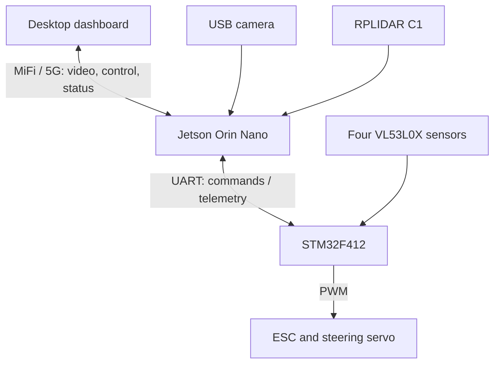

# MiniTesla | Jetson × STM32 Smart RC Car

[繁體中文](README.md) · [Architecture](docs/architecture.md) · [Deployment](docs/operation.md) · [Build logs](logs/README.md)

An embedded integration project that uses **Jetson Orin Nano for onboard vision and networking, and STM32F412 for motor, steering, and four-direction distance protection**. An onboard MiFi provides 5G connectivity. A desktop application combines annotated video, lidar scans, distance telemetry, and driving controls.

The project focuses on **AI vision and remote operation, Linux–microcontroller coordination, and multiprocessing/multithreading integration**.

## Engineering focus

| Area | Implementation | Source and evidence |
| --- | --- | --- |
| Onboard AI and remote operation | Load the trained `best.pt` model for detection, instance segmentation, and ByteTrack tracking; send annotated video over TCP and control/status over UDP | [Vehicle application](jetson/minitesla.py), [desktop dashboard](pc/pc_dashboard.py) |
| Jetson–STM32 coordination | Custom bidirectional UART framing, CRC8, four VL53L0X sensors, ESC/servo PWM, and an independent M4 protection check in a 1 ms timer interrupt | [M4 firmware](firmware/stm32f4/Core/Src/main.c), [communication bridge](jetson/minitesla_sensors/io.py) |
| Concurrency and ownership | Separate inference and transmission processes, UART/lidar threads, bounded queues, one UART writer, serialized mode transitions, stale-command rejection, and process exclusivity | [Control authority](jetson/minitesla_sensors/control.py), [runtime ownership](jetson/minitesla_sensors/runtime.py) |

The repository also preserves a `torchvision` source-build record from the vehicle environment. It includes ARM/Python 3.8 build output, CUDA extension compilation, and successful installation messages. See [build-log notes](logs/README.md) for the observed version and evidence limits.

## System responsibilities



Jetson handles inference, streaming, and higher-level decisions. M4 distance and command-timeout protection does not wait for inference. The protection action requests the established neutral output; it is not claimed as a verified active-braking implementation.

## Main demonstration scope

- Remote manual driving with annotated live video.
- Person-presence alerts, four-direction distance telemetry, and lidar monitoring.
- Reactive obstacle-avoidance patrol based on current distance readings.
- Control handoff, loss-of-link stopping, data-validity checks, and independent M4 protection.
- A unified dashboard, startup service management, and demonstration-state logging.

Person detection provides alerts; image objects are not associated with lidar ranges. Patrol is reactive, without SLAM or predefined route navigation. Inference uses `best.pt`; TensorRT, quantization, and custom CUDA kernels are not presented as completed work in this project.

## Repository and operation

| Directory | Contents |
| --- | --- |
| [`pc/`](pc/) | Four desktop programs; entry point: `pc_dashboard.py` |
| [`jetson/`](jetson/) | Vehicle application, sensor/control modules, model, lidar SDK, services, and recorder |
| [`firmware/stm32f4/`](firmware/stm32f4/) | Complete Keil project, HAL/CMSIS, and M4 source |
| [`docs/`](docs/) | Bilingual architecture, wiring, deployment, and validation notes |
| [`logs/`](logs/) | Original `torchvision` and historical M4 build logs; logs are intentionally tracked |
| [`notes/`](notes/) | Recovered operation and build-command notes |
| [`archive/`](archive/) | Original documents, photos, early source, old build products, and release notes |

With the existing working Python environment, launch the desktop application:

```bash
cd pc
python pc_dashboard.py
```

Deploy the contents of `jetson/` to `$HOME/Desktop/jetson orin nano` on the vehicle. See [deployment instructions](docs/operation.md). Open [`wheelcontrol.uvprojx`](firmware/stm32f4/MDK-ARM/wheelcontrol.uvprojx) for the M4 project.

## Version and evidence

This release merges the saved engineering project and update packages and was compared against 197 subsequently recovered Jetson files. It restores the fixed-parameter `parking_setup.py`, preserves the model and lidar SDK, and restores the lidar executable bit.

Historical logs and binaries are retained but are not evidence of a fresh build of the current firmware. Source verification and physical-vehicle validation are distinguished in [validation notes](docs/validation.md). Unuploaded local changes and complete installed computer environments are outside this recovery scope.

## Experimental extension

Experimental parking-space search, alignment, and reverse-parking code is retained for future development and research. These functions still need refinement and are excluded from the main demonstration claims.

See [THIRD_PARTY_NOTICES.md](THIRD_PARTY_NOTICES.md) for retained third-party notices.
