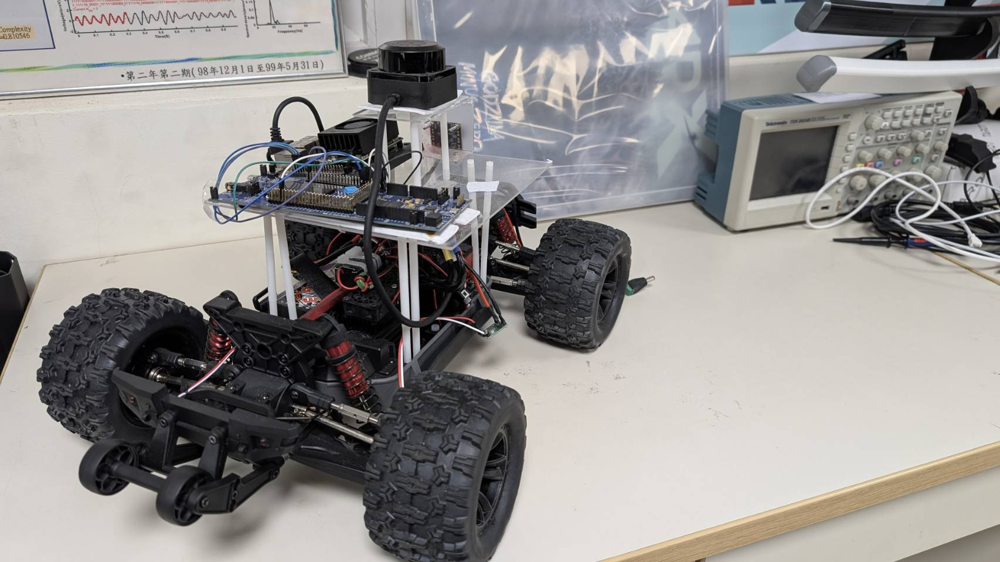
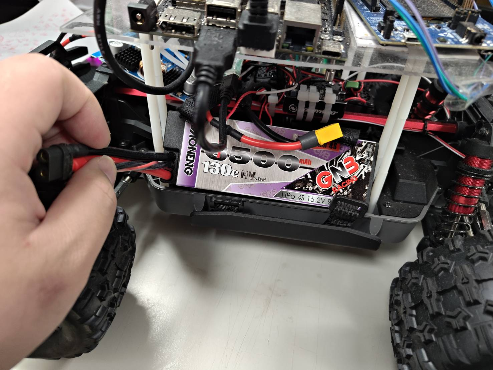
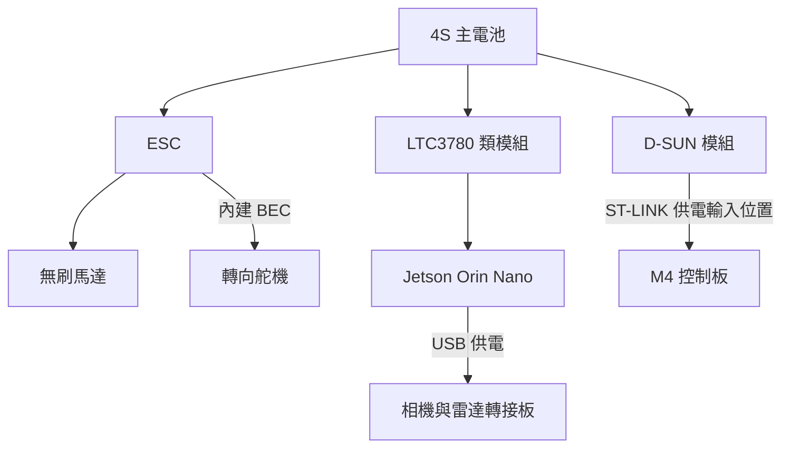
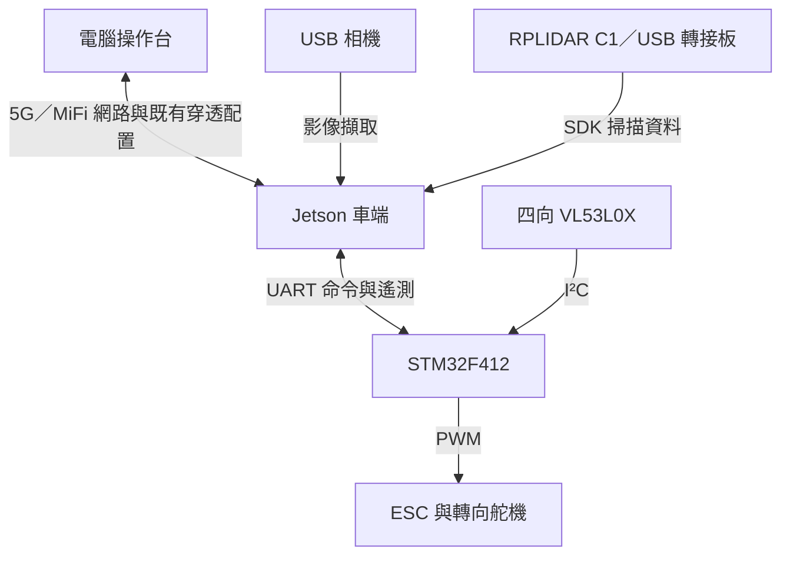

# 智慧車｜Jetson Orin Nano × STM32 嵌入式人工智慧巡邏避障系統：邊緣推論、異質運算與即時控制

> **本專案由我一人在一年內，從零開始獨立完成。**
>
> 我先進行**整車硬體規劃與元件選型**，接著完成**電源分路、穩壓供電配置與實際配線**，最後進行 **STM32 控制韌體與 Jetson 車端軟體開發**，整合多感測器、人工智慧推論、遠端操作與整車控制。

## [▶ 點此觀看智慧車實機展示影片](https://youtu.be/pAVebk_odPo)

[English](README.en.md) · [硬體與接線](docs/hardware.md) · [系統架構](docs/architecture.md) · [部署操作](docs/operation.md) · [原始建置紀錄](logs/README.md)

**「智慧車」是我從零開始獨立製作的專案。從車體與電子元件選配、電源電路安排、模組安裝與實際接線，到 Jetson 環境建置、模型訓練與部署、STM32 韌體、電腦操作介面及 5G 遠端連線，皆由我完成，並整合影像辨識、雷達與四向測距，逐步完成整車測試與部署。**

這個專案的工作橫跨硬體、Linux 車載運算、微控制器韌體與電腦操作介面：Jetson Orin Nano 執行視覺推論、網路傳輸及上層決策；STM32F412 執行 PWM、UART 封包解析與獨立距離保護。開發從各裝置的單項驗證逐步推進到整車整合，儲存庫同時保留早期程式、編譯紀錄與歷次修改說明，能追溯成品如何形成。

## 獨立完成的整車工程

| 工程領域 | 獨立完成的實作 | 系統成果 |
| --- | --- | --- |
| 硬體與供電整合 | 選配運算板、控制板、感測器與致動器；安排電池分接、穩壓供電、USB 周邊供電、BEC 舵機供電，以及板卡安裝與訊號接線 | 將車用動力、運算與控制負載接成可共同運作的整車系統 |
| Jetson 平台建置 | 建立 Python／GPU 推論環境、處理 PyTorch／torchvision 相容性、自行編譯 torchvision 的 ARM 與 CUDA 擴充 | 讓相機影像與訓練模型能接上實際車端執行環境 |
| STM32 即時控制 | 以 C 實作韌體，配置時脈、GPIO、硬體計時器與 PWM；實作 UART 解析、CRC8、四向 ToF 管理、保護狀態機與看門狗 | 將網路操作命令轉成實際油門／轉向訊號，保留獨立於 Jetson 的控制保護 |
| 感知與資料傳輸 | 整合 USB 相機、`best.pt` 分割模型、ByteTrack、RPLIDAR C1、四顆 VL53L0X；傳送影像、掃描、距離與狀態 | 操作者能同時看見車前影像、辨識結果與周邊距離 |
| 網路與遠端操作 | 使用專用 5G 網路 SIM、車載 MiFi 與既有 NAT 穿透配置；分開處理影像、控制與雷達資料通道 | 把車端裝置接到遠端電腦操作台，處理配對、失聯與恢復接管 |
| 多工與控制權整合 | 分離推論／傳輸程序、UART／雷達執行緒，加入佇列、鎖、排他開啟、資料時效與模式交接 | 避免影像運算阻塞控制，或多個工作同時爭用馬達串口 |
| 部署與操作介面 | 統一電腦操作台、服務安裝與管理、開機啟動、狀態監看與展示紀錄匯出 | 將開發時分散啟動的程式收斂成可部署、可操作、可追查的系統 |

我自行選配現成車體、開發板與電源／感測模組，獨立完成系統規劃、電源分路、安裝配線、韌體與應用開發，以及整車整合測試。使用的原廠 HAL、CMSIS、感測器 API 與雷達 SDK，來源保留於 [第三方來源與授權說明](THIRD_PARTY_NOTICES.md)。

## 從零到整車的開發路徑

以下依工程依賴整理開發階段；早期版本與目前版本分別保留，便於對照演進。

| 階段 | 做了什麼 | 留下的工程成果與證據 |
| --- | --- | --- |
| 1．車體與電子系統規劃 | 決定 Jetson／M4 分工，安裝電池、ESC、舵機、相機、雷達與板卡；安排各路供電、共地與訊號線 | [硬體照片](archive/photos/)、[供電及接線整理](docs/hardware.md) |
| 2．Jetson 到貨後的環境建置 | 建立板端執行環境，檢查 GPU 套件與 Python 相容性，準備 CUDA 編譯環境並自行建置 torchvision | [編譯指令筆記](notes/compile_torchvision.txt)、[完整建置輸出](logs/torchvision_build.log) |
| 3．先讓馬達與轉向受控 | 在 STM32 建立 PWM 輸出與 UART 命令通道，對接 Jetson 串口，確認中立值與控制範圍 | [早期 UART 橋接](archive/early_sources/jetson_motor_uart_verbose.py)、[早期 M4 程式](archive/early_sources/main(1).c)、[目前完整工程](firmware/stm32f4/) |
| 4．逐項接通感知與遠端資料 | 分別處理影像推論、電腦鍵盤控制、UART 轉送及雷達接收，再整合資料流 | [早期獨立程式](archive/early_sources/)、[雷達 SDK](jetson/rplidar_sdk-master/) |
| 5．把獨立程式整合成並行系統 | 將相機／推論、影像傳送與感測接收拆成適合的程序或執行緒，整合到車端主程式 | [早期整合版本](archive/early_sources/minitesla(2).py)、[目前車端主程式](jetson/minitesla.py) |
| 6．加入四向測距與控制保護 | 增加四顆 ToF 的獨立 XSHUT、位址分配、有效性檢查與距離回傳，將油門保護放進 M4 | [四向測距整合紀錄](archive/release_notes/01_MiniTesla_Phase1_2_Replace_v1.md)、[M4 韌體](firmware/stm32f4/Core/Src/main.c) |
| 7．處理整合後的失聯與競態 | 補上影像顯示確認、命令期限、控制權交接、單一 UART 寫入者及程序／串口排他 | [多工同步修正紀錄](archive/release_notes/04_MiniTesla_Phase4_ConcurrencyFix_v1.md)、[控制管理](jetson/minitesla_sensors/control.py) |
| 8．收斂成整車操作與部署 | 整合人物警示、反應式避障巡邏、電腦操作台、開機服務與狀態紀錄工具 | [操作台](pc/pc_dashboard.py)、[自主控制](jetson/minitesla_sensors/autonomy.py)、[服務管理](jetson/minitesla_service.py)、[紀錄器](jetson/demo_recorder.py) |

## 硬體實作：電源電路安排、模組安裝與接線

*實機組裝照片：電池、車體底盤與以隔離柱固定的多層車載電子平台。[其他原始硬體照片](archive/photos/)*

### 實車元件與配置

| 元件 | 實際用途與整合工作 |
| --- | --- |
| NVIDIA Jetson Orin Nano | 車載 Linux 運算平台；承接相機、雷達、推論與網路傳輸 |
| ST STM32F412ZGT6／M4 控制板 | 車端即時控制；完整 Keil 工程與 `.ioc` 設定保留在 `firmware/stm32f4/` |
| 4S 電池 | 整車主電源；[原始電池照片](archive/photos/104652_0.jpg) 可見 GNB／GAONENG、4S 15.2 V 與 HV 4.35 V 標籤 |
| 藍色 LTC3780 類電源模組 | 電池分接後供應 Jetson，Jetson 再供應 USB 周邊 |
| D-SUN 電源模組 | 電池另一路分接後供應 M4，使用板上 ST-LINK 的供電輸入位置 |
| ESC、無刷馬達、轉向舵機 | ESC 驅動馬達，內建穩壓輸出（BEC）供應舵機；M4 分別提供兩路 PWM 控制訊號 |
| USB 相機 | 供 Jetson 擷取影像；[相機板照片](archive/photos/104650_0.jpg) 可見 `BL-1080P-S10` 板上標示 |
| RPLIDAR C1 與原轉接板 | 由 Jetson USB 接收雷達掃描資料，對接 SDK 與轉送程式 |
| VL53L0X × 4 | 前、後、左、右配置；接到 M4 共用 I²C 線路與四條獨立 XSHUT |
| 車載 MiFi 與專用 5G 網路 SIM | 提供車端行動網路，沿用部署環境的 NAT 穿透方式 |

### 實際電源分路

這裡的設計工作包含**電源負載歸屬與分路**：Jetson 支路需要連同 USB 相機、雷達轉接板一起考慮；舵機由 ESC 的 BEC 供電；M4 從電池經 D-SUN 獨立供電，不占 Jetson 的 USB 供電預算。能由既有板卡供電的裝置就使用板卡電源，避免為每個周邊重複增加轉換模組。

上述記錄的是實車已確認的供電拓撲。電源模組的輸出設定與電流能力需要對應實際模組，不能僅憑「LTC3780」晶片名稱或外觀推定；訊號腳的 3.3 V 邏輯也不等於整塊板卡的供電輸入規格。

### 關鍵訊號配線

| 訊號 | 接線／設定 | 實作重點 |
| --- | --- | --- |
| Jetson → M4 | Jetson UART TX → STM32 PA3／USART2 RX | 車端使用 `/dev/ttyTHS0`，115200、8N1 |
| M4 → Jetson | STM32 PA2／USART2 TX → Jetson UART RX | 回傳四向距離與控制狀態；雙方共地，UART 使用 3.3 V 邏輯 |
| 舵機控制 | PA8 → TIM1 CH1 → 舵機訊號線 | 訊號由 M4 產生，供電來自 BEC |
| ESC 控制 | PA1 → TIM2 CH2 → ESC 訊號線 | 速度與中立命令轉換成脈寬 |
| 四向 ToF 共用匯流排 | PB8＝SCL、PB9＝SDA | 開漏軟體 I²C；感測器讀取由 M4 管理 |
| 前／後／左／右 XSHUT | PG10／PG11／PG12／PG13 | 逐顆啟用並分配不同位址 |
| 前／後／左／右 I²C 位址 | `0x30`／`0x31`／`0x32`／`0x33` | 解決四顆同預設位址裝置共用匯流排的衝突 |

接線對應可在 [`main.c`](firmware/stm32f4/Core/Src/main.c) 的 `pwm_init`、`uart_init` 與 ToF 初始化中核對。已保存的車體設定包括車長 **47.4 cm**、車寬 **32.8 cm**、軸距 **27.5 cm**；雷達原始 0° 朝前、橫向置中、角度順時針，見 [車體設定](jetson/minitesla_sensors/vehicle_config.py)。

## Jetson：從套件環境到車載影像推論

車端的第一個問題是把 Linux、Python、GPU 套件與實際裝置接成可執行環境。開發過程處理了 PyTorch／torchvision 的套件相容性，並留下從官方原始碼建置 torchvision 的指令與輸出。

- 編譯筆記包含 CUDA 路徑、`TORCH_CUDA_ARCH_LIST="8.7"`、`MAX_JOBS=1` 與不隔離建置環境的安裝方式。
- 實際建置紀錄包含 **Linux AArch64、Python 3.8、`nvcc`、`compute_87`／`sm_87`**，以及 `Successfully built`／`Successfully installed` 訊息。
- 保存的成功紀錄版本是 **`torchvision 0.16.1+fdea156`**；另一份指令筆記記載下載 `v0.15.1`。兩者是不同歷史證據，版本差異見 [建置紀錄說明](logs/README.md)。

我將自行訓練產出的分割模型部署到車端。推論流程由 USB 相機取像，載入訓練完成的 [`best.pt`](jetson/best.pt)，使用 Ultralytics 的分割模型與 ByteTrack 追蹤，再以 OpenCV 繪製結果、JPEG 編碼並傳回電腦。專案的工作是將模型接入完整車載感知與操作流程；現行展示採用 `.pt` 模型推論，自行編譯 torchvision 是有原始紀錄的環境整合成果。

**可直接追查：** [車端影像處理](jetson/minitesla.py) · [編譯指令](notes/compile_torchvision.txt) · [完整編譯紀錄](logs/torchvision_build.log)

## STM32：把命令變成真正的馬達控制

### 硬體 PWM 與雙向 UART

韌體直接配置 TIM1／TIM2 產生兩路 PWM。現行時基使用 16 MHz，預除頻器 `PSC=159`、週期暫存器 `ARR=1013`，得到約 **98.6 Hz**；每個計數為 **10 μs**，中立值 `152` 對應 **1.52 ms** 脈寬。這些是程式中的時序設定，與上層傳入的速度／轉向數值有明確對應。

| 控制量 | 現行韌體設定 |
| --- | --- |
| 舵機 | `94–210`，中位 `152` |
| ESC | 現行保護版本限制為 `142–160`，中立 `152` |
| UART 命令 | `55 AA 02 SEQ speed turn CRC8`，CRC-8 多項式 `0x07` |
| 命令接收 | 完整封包通過校驗後才更新命令與接收時間；錯誤／不完整資料不視為新控制輸入 |

M4 同時回傳四向距離、有效性與保護狀態，Jetson 不只有「送速度」單向控制，也能監督控制端是否正常。遙測封包為 79 位元組，主迴圈每 50 ms 嘗試透過 TXE 中斷傳送；忙碌時跳過，避免排隊累積過時的狀態。

### 四向測距與獨立保護

四顆 VL53L0X 上電時有相同預設位址。韌體先控制各顆 XSHUT，再逐顆啟用、重新配置位址，最後循環讀取。這涉及 GPIO 控制、I²C 平台介面、原廠 API 整合、錯誤處理與資料時間戳，並非把四顆模組接到同一組線就完成。

開機先輸出 ESC 與舵機中立值，再初始化感測器。保護策略由 **TIM5 的 1 ms 控制時基**檢查，與相機推論及網路傳輸分開。控制中斷不做 I²C 讀取、延遲或列印，優先序高於 UART 中斷；主迴圈負責感測讀取與遙測封包準備，USART2 中斷負責命令接收與位元組收發；獨立看門狗（IWDG）只有在主迴圈與控制時基皆持續推進時才刷新。

| 條件 | 現行程式策略 |
| --- | --- |
| 任一方向距離小於或等於 300 mm | 鎖定油門為 ESC 中立值 |
| 任一必要 ToF 無效，或資料超過 120 ms 未更新 | 不把未知距離當成安全空間，鎖定油門 |
| UART 命令超過 300 ms 未更新 | 鎖定油門 |
| 障礙解除 | 四向皆至少 400 mm 且持續至少 500 ms，確認中立命令後，等待後續新的油門命令才恢復行駛 |

保護鎖定時，合法且新鮮的轉向命令仍可保留；**ESC 中立輸出不是已驗證的主動煞車**。1 ms 是策略檢查週期，300／400 mm 是配置門檻，不能當成已量測的整車反應時間或煞停距離。

## 5G 遠端操作與多通道資料流

5G 採用**專用網路 SIM 插入車載 MiFi，再分享網路給車端**的方式。遠端連線使用既有 NAT 穿透部署；程式端由 Jetson 主動送出 `HELLO`，讓電腦端建立控制對端資訊。`HELLO` 是配對機制，不能單獨取代行動網路的穿透配置。

| 資料通道 | 功能與整合重點 |
| --- | --- |
| TCP 7000：影像 | 傳送 JPEG 影像與影格序號；以車端擷取時間及接收端顯示確認判斷影像時效 |
| UDP 5000：控制與狀態 | 車端配對、遠端心跳、操作命令、模式與感測狀態回報 |
| UDP 6000：雷達 | 銜接原廠 SDK、車端接收與電腦雷達畫面；雷達串口為 `/dev/ttyUSB0`、460800 |
| UART 115200：Jetson ↔ M4 | 封包校驗、速度／轉向命令與四向測距遙測 |

雷達整合也包含修改原廠 C++ `ultra_simple` 範例：將掃描角度、距離與品質轉成 `angle,distance,quality`，送到本機 UDP，再由車端程式整理與轉送，見 [SDK 範例修改](jetson/rplidar_sdk-master/app/ultra_simple/main.cpp)。

網路恢復後，系統經待命與重新接管流程恢復操作，不直接重送先前油門。這把「連線重新建立」與「允許車輛重新移動」分開處理。

## 多工整合：讓影像、感測與控制能一起工作

| 執行單位 | 負責的工作 | 資源與同步安排 |
| --- | --- | --- |
| 影像推論程序（Process） | 相機擷取、模型推論、追蹤、標註與編碼 | 使用 `multiprocessing`，經有限容量佇列交付資料 |
| 影像傳送程序 | TCP 連線與影格傳輸 | 與推論分開，避免傳輸等待直接堵住相機／推論工作 |
| UART 執行緒（Thread） | M4 收發及控制命令派送 | 單一串口持有者與寫入者，避免多個模式直接爭用裝置 |
| 雷達執行緒 | 接收掃描、更新感測快照與轉送 | 與 UART 接收分離，按資料時間判斷有效性 |
| 控制管理器 | 手動／待命／自主／故障切換 | 模式判斷、健康檢查與 UART 派送共用控制鎖 |
| 電腦媒體子程序與操作介面 | 影像／雷達接收與顯示、鍵盤控制 | 媒體處理與操作視窗分工，納入焦點及影像狀態 |

整合中特別處理過一個競態：**一個工作已取出舊油門，另一個工作剛切成故障狀態，前者卻仍可能把舊油門送出。** 修正方式是把控制判斷和 UART 派送放在同一控制鎖內，取得鎖後重新檢查時間與感測健康；影像推論和長時間網路等待則放在鎖外。

同時加入程序鎖、pySerial 排他開啟與 Linux 終端裝置排他設定，防止重複啟動的新實例再占用串口。監看工具只讀取快照，不另開 UART。這些措施各自處理程序重複、裝置爭用、共享狀態和舊資料問題；已進入串口傳送的封包無法撤回，因此仍保留 M4 的獨立保護。

**程式證據：** [程序與串口排他](jetson/minitesla_sensors/runtime.py) · [控制權管理](jetson/minitesla_sensors/control.py) · [UART／雷達工作](jetson/minitesla_sensors/io.py) · [當時的同步修正說明](archive/release_notes/04_MiniTesla_Phase4_ConcurrencyFix_v1.md)

## 從分散啟動到統一部署

電腦端入口是 [`pc_dashboard.py`](pc/pc_dashboard.py)，整合駕駛操作、辨識影像、雷達、四向距離及狀態。車端 [`minitesla_service.py`](jetson/minitesla_service.py) 管理主程式、雷達讀取與紀錄器的服務安裝、開機啟動、停止、重啟與紀錄查閱。

[`sensor_status.py`](jetson/sensor_status.py) 讀取感測快照；[`demo_recorder.py`](jetson/demo_recorder.py) 可匯出 `samples.csv`、`events.csv`、`records.jsonl` 與摘要，用來追查模式變化、距離及故障原因。保留的原始建置 log 與之後行駛時產生的狀態紀錄用途不同。

| 主要展示內容 | 對應工程能力 |
| --- | --- |
| 遠端手動駕駛與辨識影像回傳 | 視覺推論、編碼、網路傳輸、操作介面與馬達控制的完整鏈路 |
| 人物警示、雷達及四向距離監看 | 異質感測資料接入、狀態整合與回傳 |
| 反應式避障巡邏 | 以當下距離決策、控制權交接與保護條件整合 |
| 失聯停止與重新接管 | 心跳、影像時效、感測有效性及兩層控制保護 |
| 開機服務與紀錄匯出 | Linux 部署、自動啟動、程序管理與問題追查 |

人物辨識提供警示，障礙處理由距離感測支援；目前沒有影像人物與雷達距離的物件級配對。巡邏依即時距離反應，不包含 SLAM 地圖導航。原始資料中的 TensorRT、量化或自訂 CUDA 等規劃不列為本專案完成成果。

### 實機展示影片

## 如何檢查這些實作

| 想查看的內容 | 入口 |
| --- | --- |
| 完整車端執行流程 | [`jetson/minitesla.py`](jetson/minitesla.py) 與 [`minitesla_sensors/`](jetson/minitesla_sensors/) |
| MCU 控制與測距 | [`main.c`](firmware/stm32f4/Core/Src/main.c)、[`wheelcontrol.uvprojx`](firmware/stm32f4/MDK-ARM/wheelcontrol.uvprojx) |
| 電腦端操作 | [`pc/`](pc/) |
| 原始環境建置證據 | [`logs/`](logs/)、[`notes/`](notes/) |
| 開發演進 | [`archive/early_sources/`](archive/early_sources/)、[`archive/release_notes/`](archive/release_notes/) |
| 硬體與原始文件 | [`archive/photos/`](archive/photos/)、[`archive/documents/`](archive/documents/) |
| 部署與版本範圍 | [操作說明](docs/operation.md)、[驗證說明](docs/validation.md) |

發布時已核對 Python 語法、工程相對路徑、文件連結與來源檔案內容。歷史 M4 建置 log 保留作為開發紀錄，不當成目前韌體重新編譯的證明；目前配置數值也不轉寫成未曾提供的實測效能。完整工程與紀錄保留下來，讓讀者能從首頁一路追查到程式與原始證據。

### 實驗性保留

專案另保留車位搜尋、自動對位與倒車入庫的實驗性程式。相關功能仍待完善，僅作為後續擴充與研究參考，未納入本次主要展示成果。
