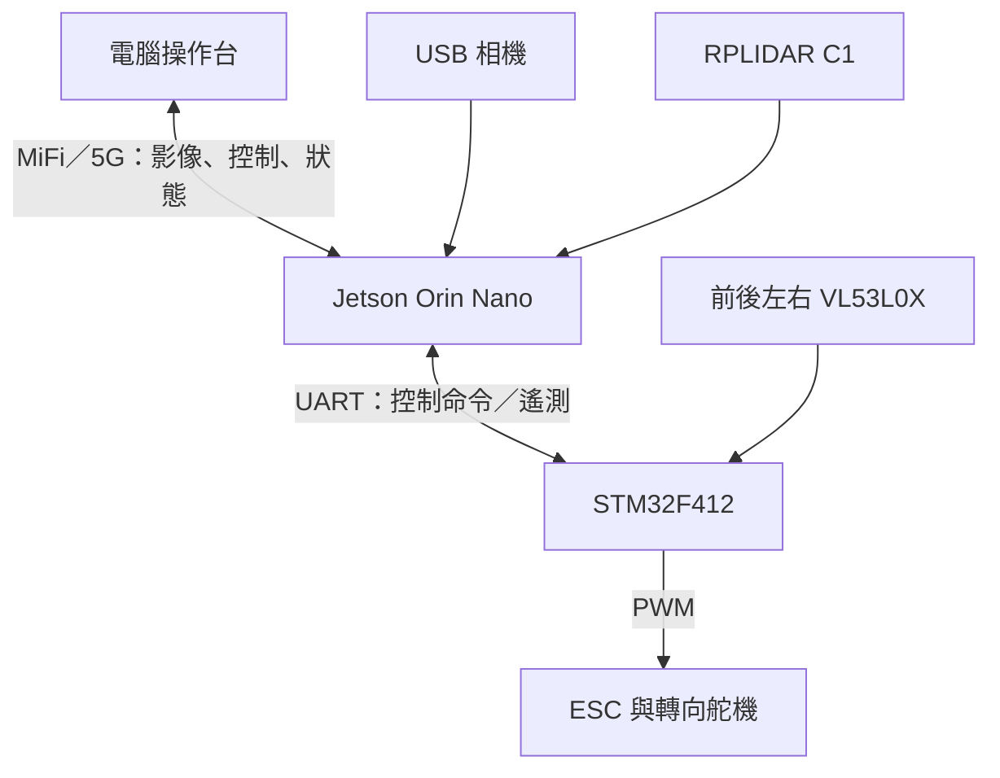

# MiniTesla｜Jetson × STM32 智慧遙控車

[English](README.en.md) · [系統架構](docs/architecture.md) · [部署操作](docs/operation.md) · [編譯紀錄](logs/README.md)

以 **Jetson Orin Nano 處理車載視覺與網路傳輸，STM32F412 處理馬達、轉向及四向距離保護**的嵌入式整合專案。車載行動分享器（MiFi）提供 5G 網路，電腦操作台整合辨識影像、雷達掃描、距離回報與駕駛控制。

此專案著重三件事：**人工智慧視覺與遠端遙控、Linux 與微控制器協同控制、多程序／多執行緒整合**。

## 核心實作

| 主軸 | 實作內容 | 原始碼與證據 |
| --- | --- | --- |
| 車載人工智慧視覺與遠端操作 | 載入訓練模型 `best.pt`，進行目標偵測、實例分割與 ByteTrack 追蹤；以 TCP 回傳辨識影像，以 UDP 交換控制與狀態 | [車端主程式](jetson/minitesla.py)、[電腦操作台](pc/pc_dashboard.py) |
| Jetson／STM32 分工 | 自訂雙向 UART 協定、CRC8 校驗、M4 四向 VL53L0X 量測、ESC／舵機 PWM 輸出；M4 以 1 ms 計時器中斷獨立判斷保護條件 | [M4 韌體](firmware/stm32f4/Core/Src/main.c)、[通訊橋接](jetson/minitesla_sensors/io.py) |
| 並行處理與資源管理 | 影像推論與傳送分程序，UART／雷達接收分執行緒；有限容量佇列、單一 UART 寫入者、模式切換鎖、舊命令拒絕與程序排他 | [控制管理](jetson/minitesla_sensors/control.py)、[程序與串口排他](jetson/minitesla_sensors/runtime.py) |

為處理車端套件相容性，另有自行編譯 `torchvision` 的實作紀錄。保存的紀錄包含 ARM／Python 3.8 建置、CUDA 擴充編譯及成功安裝訊息；詳細版本與證據範圍見[編譯紀錄說明](logs/README.md)。

## 系統分工



Jetson 保留較重的推論、影像傳輸與上層決策；M4 的距離及命令逾時保護不依賴影像推論完成。保護動作是回到既定中立輸出，沒有把它宣稱為已驗證的主動煞車。

## 主要展示範圍

- 遠端手動駕駛與即時辨識影像回傳。
- 人物出現警示、四向測距與雷達掃描監看。
- 四向距離驅動的反應式避障巡邏。
- 控制權交接、失聯停止、感測有效性判斷與 M4 獨立保護。
- 統一操作介面、開機服務管理與展示狀態紀錄。

人物辨識用於警示；目前沒有將影像人物與雷達距離做物件級對應。巡邏依當下距離決策，沒有同步定位與建圖（SLAM）或預設路線導航。推論沿用 `best.pt`；未將 TensorRT、模型量化或自訂 CUDA 運算核心列為此專案成果。

## 閱讀與使用

| 位置 | 內容 |
| --- | --- |
| [`pc/`](pc/) | 電腦端四個正式程式，入口為 `pc_dashboard.py` |
| [`jetson/`](jetson/) | 車端主程式、感測控制模組、模型、雷達 SDK、服務與紀錄工具 |
| [`firmware/stm32f4/`](firmware/stm32f4/) | M4 完整 Keil 工程、HAL／CMSIS 與韌體來源 |
| [`docs/`](docs/) | 中英文技術架構、接線、部署與版本核對說明 |
| [`logs/`](logs/) | 原始 `torchvision` 與歷史 M4 建置紀錄，未用忽略規則排除 |
| [`notes/`](notes/) | 找回的操作與編譯指令筆記 |
| [`archive/`](archive/) | 原始文件、照片、早期程式、舊建置產物及歷次更新說明 |

使用原本已完成安裝的 Python 環境，在電腦端執行：

```bash
cd pc
python pc_dashboard.py
```

Jetson 的部署路徑沿用 `$HOME/Desktop/jetson orin nano`，將 `jetson/` 內的內容放到該處。完整啟動及服務操作見[部署說明](docs/operation.md)。M4 工程入口為 [`wheelcontrol.uvprojx`](firmware/stm32f4/MDK-ARM/wheelcontrol.uvprojx)。

## 版本與證據

此發布內容由已保存工程與歷次更新整併，並核對後來找回的 197 個 Jetson 檔案。發布版補回固定參數版 `parking_setup.py`，保留模型與雷達套件，並補上雷達執行權限。

原始紀錄與歷史產物均保留，但不把舊韌體建置紀錄或舊二進位檔當作目前韌體的建置證明。程式核對與實車驗證的範圍分開記錄於[版本與驗證說明](docs/validation.md)。未曾上傳的電腦環境與後續本機修改不屬於此儲存庫的完整備份範圍。

## 實驗性擴充

專案另保留車位搜尋、自動對位與倒車入庫的實驗性程式。相關功能仍待完善，僅作為後續擴充與研究參考，未納入本次主要展示成果。

第三方來源與授權保留方式見 [THIRD_PARTY_NOTICES.md](THIRD_PARTY_NOTICES.md)。
