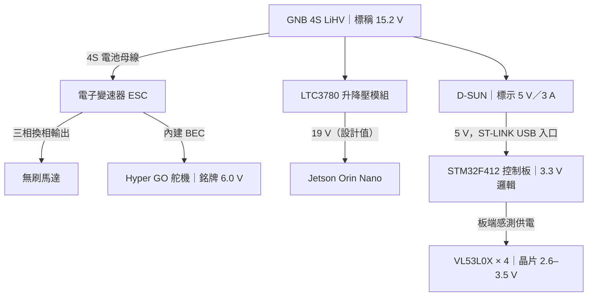
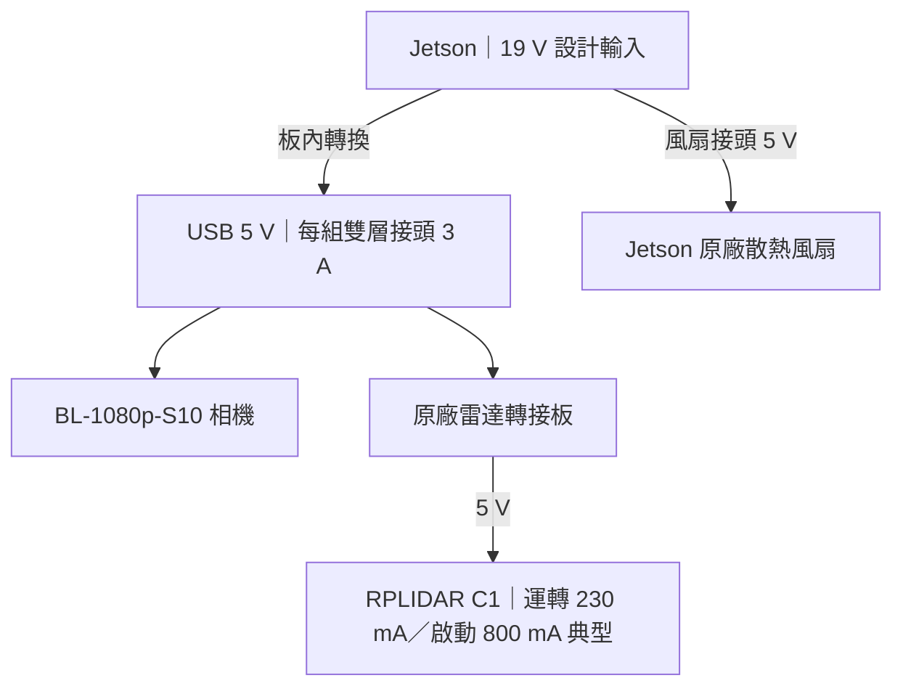

# 硬體、電源與接線／Hardware, power, and wiring

智慧車的硬體整合包含元件選配、三路電源分接、穩壓模組、板卡固定、感測器安裝與訊號配線。主電池供應動力、Jetson 與 M4 三個支路；周邊使用所連接板卡或 ESC 的穩壓電源。

The vehicle uses three battery branches for propulsion, Jetson computing, and M4 control. Hardware integration covers component selection, power conversion, load allocation, mounting, sensor placement, and signal wiring.

## 電源分路與電壓／Power distribution and voltages

主電池與控制支路：

Jetson 周邊支路：

**19 V** 是原始專案文件的 Jetson 設計電源軌；**5 V／3 A** 是 D-SUN 包裝標示；**6.0 V** 是舵機銘牌值。電池的 **15.2 V** 是標稱電壓，**17.4 V** 是四顆電芯各 4.35 V 的充電上限合計。

The Jetson's **19 V** is the original project design rail, **5 V / 3 A** comes from the D-SUN packaging, and **6.0 V** is the servo's label value. **15.2 V** is the battery's nominal voltage; **17.4 V** is the sum of four 4.35 V cell charge limits.

## 元件電氣規格／Electrical specifications

| 元件 | 供電與電壓 | 電流、容量或輸出規格 | 來源 |
| --- | --- | --- | --- |
| GNB／GAONENG 4S LiHV 電池 | 標稱 15.2 V；單節充電上限 4.35 V，四串合計 17.4 V | 6000 mAh、130C 銘牌標示；標稱能量 91.2 Wh（15.2 V × 6 Ah） | [電池照片](../archive/photos/104652_0.jpg)、[GNB 規格](#規格來源references) |
| 藍色 LTC3780 升降壓模組 | 4S 電池輸入；Jetson 設計輸出 19 V | - | [模組照片](../archive/photos/104654_0.jpg)、原始專案設計文件 |
| NVIDIA Jetson Orin Nano 開發套件 | 設計電源軌 19 V，經直流電源插座輸入；原廠載板規格 v1.2 的插座範圍為 9–20 V | 主機、USB 周邊及散熱風扇共用此支路；主機工作電流隨運算負載變化 | NVIDIA 載板規格 |
| Jetson USB Type-A 電源 | 5 V，供應相機及雷達轉接板 | 每組雙層接頭共用 3 A 輸出限流 | NVIDIA 硬體配置指南 |
| D-SUN 降壓模組 | 4S 電池輸入；包裝標示 MP1584EN、輸出 5 V | 包裝標示輸出 3 A；MP1584 晶片資料表輸入範圍 4.5–28 V | [包裝照片](../archive/photos/104661_0.jpg)、MPS MP1584 |
| STM32F412ZGT6 控制板 | D-SUN 的 5 V 接到 ST-LINK USB 供電入口；板上 MCU／UART 邏輯 3.3 V | - | [實車入口照片](../archive/photos/104658.jpg)、[韌體工程](../firmware/stm32f4/) |
| 電子變速器（ESC） | 直接接 4S 主電池母線 | - | 原車電子組件與實車配線 |
| 無刷馬達（BLDC） | ESC 三相換相輸出 | - | 原車動力組件 |
| ESC 內建穩壓輸出（BEC） | 供應轉向舵機；輸出設定：- | - | 實車配線 |
| Hyper GO 轉向舵機 | 銘牌 6.0 V；供電來自 ESC BEC | 銘牌扭矩 35 kg·cm、速度 0.13 秒／60°；工作／堵轉電流、完整允許電壓範圍：- | [舵機照片](../archive/photos/104651_0.jpg) |
| USB 相機 BL-1080p-S10 | Jetson USB 5 V | - | [相機板照片](../archive/photos/104650_0.jpg) |
| 雷達原廠 USB 轉接板 | Jetson USB 5 V；向雷達輸出 5 V | - | [轉接板照片](../archive/photos/104653_0.jpg)、SLAMTEC 開發套件手冊 |
| SLAMTEC RPLIDAR C1 | 5 V；允許範圍 4.8–5.2 V | 5 V、10 Hz 時：運轉典型 230 mA、最大 260 mA；啟動典型 800 mA | SLAMTEC C1 資料表，圖表 2-7 |
| VL53L0X 感測器晶片 × 4 | 晶片供電 2.6–3.5 V；原廠電流測試條件為 2.8 V | 單顆量測典型 19 mA、峰值可達 40 mA；四顆算術合計典型 76 mA、峰值 160 mA | ST VL53L0X 資料表 |
| VL53L0X 感測器載板 | 使用 M4 板端電源；載板型號、VIN 接腳電壓：- | - | 四向 ToF 整合配置 |
| Jetson 原廠散熱器與風扇 | J13 風扇接頭 5 V；散熱器本體為被動元件 | - | NVIDIA 載板規格，風扇接頭表 |
| ESC／馬達原廠散熱組件 | 沿用原廠線組；風扇電壓：- | - | 原車散熱配置 |
| 車載行動熱點（MiFi） | - | - | 5G 網路部署配置 |

各欄以「設計值」「銘牌」「典型」「最大」區分規格用途。

### 各路負載歸屬

- **動力支路：**主電池直接供應 ESC；ESC 向無刷馬達輸出三相驅動，內建 BEC 供應舵機。M4 的兩路 PWM 僅傳送控制訊號。
- **Jetson 支路：**LTC3780 供應 Jetson，Jetson 再供應 USB 相機、雷達轉接板、C1 及板載風扇。USB 接頭的電流限制以每組雙層接頭合計計算。
- **M4 支路：**電池分接至 D-SUN，再以 5 V 經 ST-LINK USB 入口供應控制板；四向 ToF 使用控制板電源。這一路不占 Jetson USB 供電預算。
- **共地與訊號：**Jetson、M4、ESC 控制端與感測器共用訊號參考地。UART、PWM、I²C 與 XSHUT 分開接到對應訊號腳。

### 電流規格在設計中的用途

C1 的運轉典型功率約 **1.15 W**（5 V × 0.23 A），啟動典型功率約 **4 W**（5 V × 0.8 A）；USB 負載配置同時涵蓋啟動與穩態。這些值為原廠規格換算，不含 USB 轉接板。

四顆 VL53L0X 的 **76 mA** 為單顆典型量測電流的算術合計；原廠條件為 2.8 V、23°C、33 ms 量測時間預算。**160 mA** 是四顆各 40 mA 的峰值相加，用於感測電源估算，不含載板其他負載。

D-SUN 標示的 **3 A** 對應上游降壓模組輸出能力。控制板入口、板內穩壓器及周邊各有自己的電流限制，規格表分別列示。

## 馬達電磁干擾與工程取捨／Motor EMI and engineering trade-off

整車整合過程中，馬達運轉造成的電磁干擾（EMI）影響車端通訊。當時可用材料與剩餘開發時間有限，因此先以 UART 建立 Jetson 與 M4 的控制通道，搭配 CRC-8 校驗、錯誤封包捨棄、封包重新同步與命令逾時保護。

這項處理已使實車能正常運行。現階段完成的是通訊資料驗證與故障處理；進一步的硬體干擾抑制留待後續改版。電源分路與共地接線如前述，通訊封包與錯誤處理詳見[系統架構](architecture.md)。

Motor-generated EMI affected onboard communication during vehicle integration. With limited materials and development time remaining, I used UART for the Jetson–M4 control link, together with CRC-8, corrupted-frame rejection, frame resynchronization, and command-timeout protection.

This approach enabled normal vehicle operation. The implemented response focuses on communication integrity and fault handling; further hardware EMI suppression remains a future revision. Power branches and common-ground wiring are described above; the [system architecture](architecture.md) documents the protocol and error handling.

## M4 接線／M4 pin assignments

| 介面／Interface | 接線／Connection | 電氣用途／Purpose |
| --- | --- | --- |
| M4 板卡供電／Board power | D-SUN 5 V → ST-LINK USB 供電入口 | 5 V 供電／power |
| Jetson → M4 UART | Jetson TX → PA3／USART2 RX | 115200、8N1；3.3 V 邏輯／logic |
| M4 → Jetson UART | PA2／USART2 TX → Jetson RX | 四向距離與控制狀態／ranging and status |
| 舵機控制／Servo control | PA8／TIM1 CH1 → 舵機訊號線 | PWM；舵機電源接 BEC／servo power from BEC |
| ESC 控制／ESC control | PA1／TIM2 CH2 → ESC 訊號線 | PWM |
| ToF 時脈／SCL | PB8 | 開漏軟體 I²C／open-drain software I²C |
| ToF 資料／SDA | PB9 | 開漏軟體 I²C／open-drain software I²C |
| 前／後／左／右 XSHUT | PG10／PG11／PG12／PG13 | 個別啟用與位址配置／individual enable and addressing |
| 共地／Common ground | Jetson、M4、ESC 控制端、感測器 GND | 訊號參考地／signal reference |

ToF 使用一組共用 I²C 匯流排與四條獨立 XSHUT。上電初始化時先將感測器全部關閉，再逐顆啟用並分配位址。程式位於 [`main.c`](../firmware/stm32f4/Core/Src/main.c)。

| 方向／Direction | 七位元位址／7-bit address | ST API 左移後表示／Shifted API address |
| --- | --- | --- |
| 預設／Default | `0x29` | `0x52` |
| 前／Front | `0x30` | `0x60` |
| 後／Rear | `0x31` | `0x62` |
| 左／Left | `0x32` | `0x64` |
| 右／Right | `0x33` | `0x66` |

## 車體尺寸與感測座標／Geometry and sensor coordinates

| 設定／Setting | 數值／Value |
| --- | --- |
| 車長／Length | 47.4 cm |
| 車寬／Width | 32.8 cm |
| 軸距／Wheelbase | 27.5 cm |
| 車尾至後軸中心／Rear overhang | 14 cm |
| 左／右轉彎半徑／Left and right turning radius | 各 48 cm／48 cm each |
| 雷達縱向位置／Lidar longitudinal position | 從車尾向前 30 cm／30 cm forward of the tail |
| 雷達橫向位置／Lidar lateral position | 車身中心線／centerline |
| 雷達角度／Lidar angles | 原始 0° 朝車頭，遞增方向順時針／raw 0° forward, clockwise positive |

固定參數位於 [`vehicle_config.py`](../jetson/minitesla_sensors/vehicle_config.py)，程式啟動時直接載入。停車幾何與倒車入庫仍屬[測試版擴充](experimental.md)。

## English: electrical integration

The GNB battery is a **6000 mAh, 130C, 4S LiHV pack rated at 15.2 V nominal**. Its label specifies 4.35 V per cell at the charge limit. The ESC connects directly to this battery bus and supplies commutated three-phase power to the motor. Its BEC powers the Hyper GO servo, whose label states **6.0 V, 35 kg·cm, and 0.13 s / 60°**.

The Jetson branch uses the **19 V design rail** documented in the original project plan. The reference carrier-board specification v1.2 lists a 9–20 V DC-jack input range. The Jetson provides **5 V** to its USB peripherals and original fan. Each dual-stacked USB Type-A connector has a shared **3 A** VBUS limit.

The original USB adapter supplies the C1 lidar at **5 V**. C1 permits **4.8–5.2 V** and specifies **230 mA typical / 260 mA maximum running current at 5 V and 10 Hz**, with **800 mA typical startup current**. Adapter overhead is separate.

The independent M4 branch uses the **D-SUN converter marked MP1584EN, 5 V / 3 A**, connected to the controller's ST-LINK USB power input. MCU/UART logic is **3.3 V**. The four ToF sensors use the M4 board supply. The VL53L0X IC specification is **2.6–3.5 V**, with **19 mA typical ranging current per sensor and peaks up to 40 mA**. The 76 mA typical and 160 mA peak totals are arithmetic sums for four sensor ICs, excluding carrier overhead; current specifications use the manufacturer's 2.8 V, 23°C, 33 ms conditions.

The specification table distinguishes design values, labels, and manufacturer typical/maximum values. The board's own power-path limits are separate from the upstream converter's 3 A label.

The M4 generates control signals only; propulsion and servo power remain on the ESC branch. All control interfaces share ground. The connection and address tables above give the complete firmware pin mapping and distinguish seven-bit I²C addresses from the left-shifted form used by the ST API.

## 規格來源／References

1. [GNB／GAONENG 4S LiHV 6000 mAh、15.2 V、130C 原廠規格](https://www.gaoneng.shop/products/gaoneng-gnb-lihv-4s-15.2v-6000mah-130c-lcg-cabled-hard-case-lipo-battery-xt90)。
2. [NVIDIA Jetson Orin Nano 載板規格](https://developer.nvidia.com/downloads/assets/embedded/secure/jetson/orin_nano/docs/jetson_orin_nano_devkit_carrier_board_specification_sp.pdf)：直流輸入、板端電源與 J13 風扇接頭。
3. [NVIDIA 硬體配置指南](https://docs.nvidia.com/jetson/orin-nano-devkit/user-guide/hardware_layout.html)：USB Type-A 每組雙層接頭的 3 A 限流。
4. [MPS MP1584 原廠資料](https://www.monolithicpower.com/en/mp1584.html)：晶片輸入範圍與輸出能力；實裝模組包裝見 [104661_0.jpg](../archive/photos/104661_0.jpg)。
5. [SLAMTEC C1 資料表](https://bucket-download.slamtec.com/6801eb5f9d98927b8397ef40b64ce94049a32a49/SLAMTEC_rplidar_datasheet_C1_v1.0_en.pdf)：第 13 頁供電電壓與啟動／運轉電流。
6. [SLAMTEC C1 開發套件手冊](https://bucket-download.slamtec.com/54b4c03d64a293b2721639f0cd21edee209b886b/SLAMTEC_rplidarkit_usermanual_C1_v1.0_en.pdf)：原廠 USB 轉接板與供電介面。
7. [ST VL53L0X 資料表](https://www.st.com/resource/en/datasheet/vl53l0x.pdf)：供電範圍、量測電流與測試條件。
8. [Analog Devices LTC3780 原廠資料](https://www.analog.com/en/products/ltc3780.html)：升降壓控制器架構與運作原理。
9. [原始硬體照片](../archive/photos/)與[原始設計文件](../archive/documents/)：電池、相機、舵機、D-SUN、電源模組與實車組裝紀錄。
